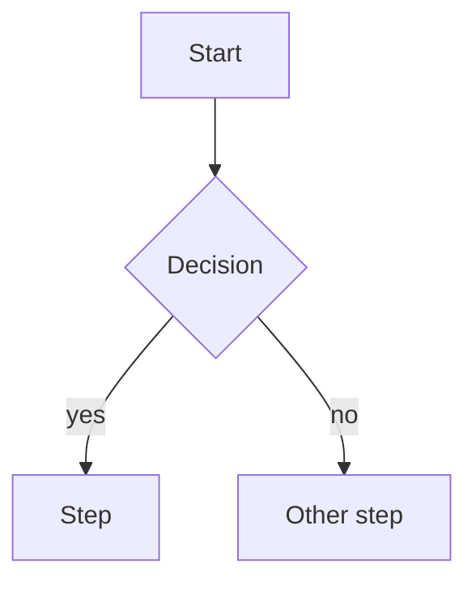

# ระบบจองรถ — User flows

Status: DRAFT

<!-- Written by Claude in /discovery. Each flow has a stable ID (F01, F02 …) used by
     screens (S..), plan stages and e2e tests. Changes after approval go through a CR. -->

## Flow index

| ID | Flow | Actor | Priority | Screens |
|---|---|---|---|---|
| F01 | | | must | S01, S02 |

---

## F01 — <name>

- **Actor:**
- **Trigger:**
- **Preconditions:**
- **Outcome:**

**Steps**
1.
2.

**Edge cases**
| Case | What the user sees / what happens |
|---|---|
| No data yet (empty) | |
| Validation error | |
| No permission | |
| Network / server error | |
| Someone else changed the same record | |

**Business rules**
- BR-F01-1:

**Open questions**
-
