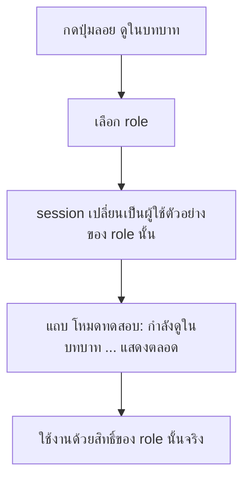
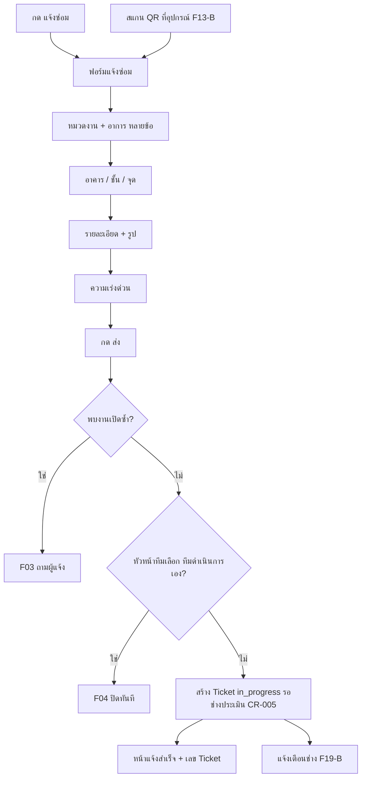
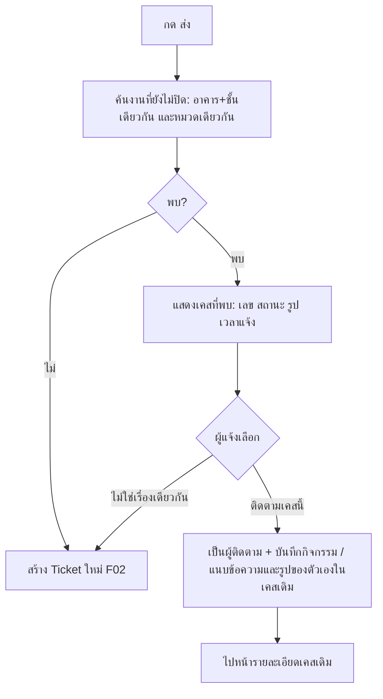
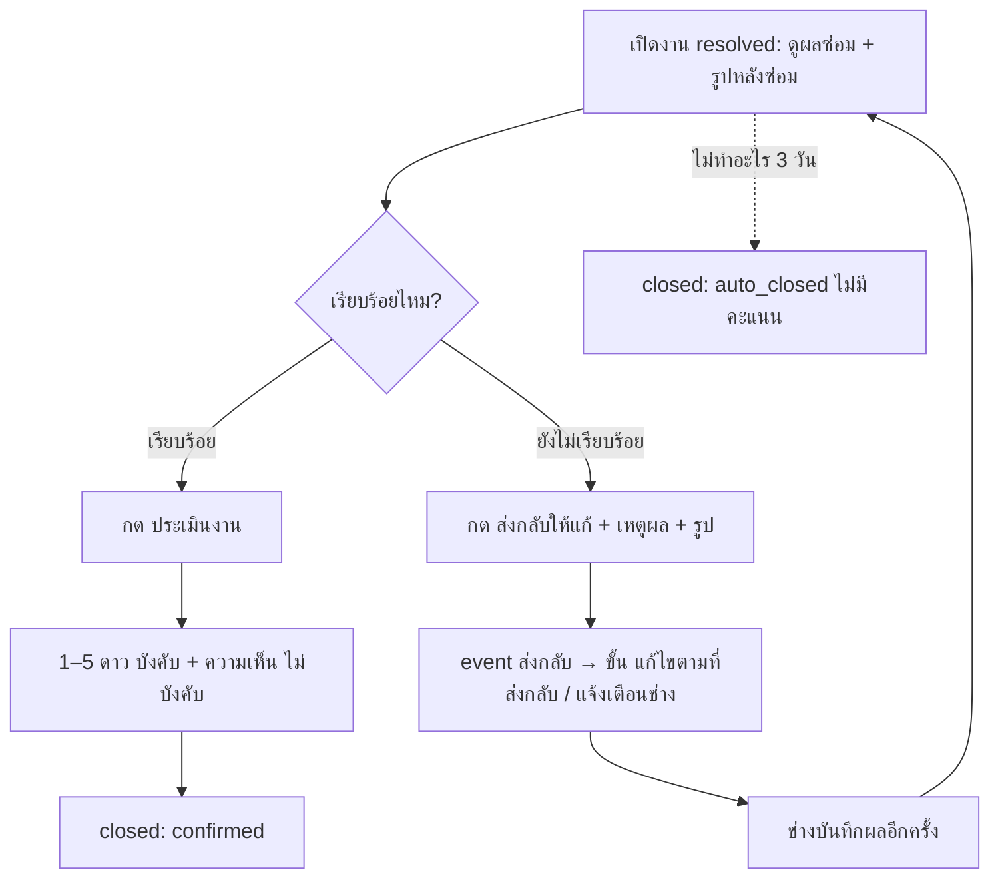
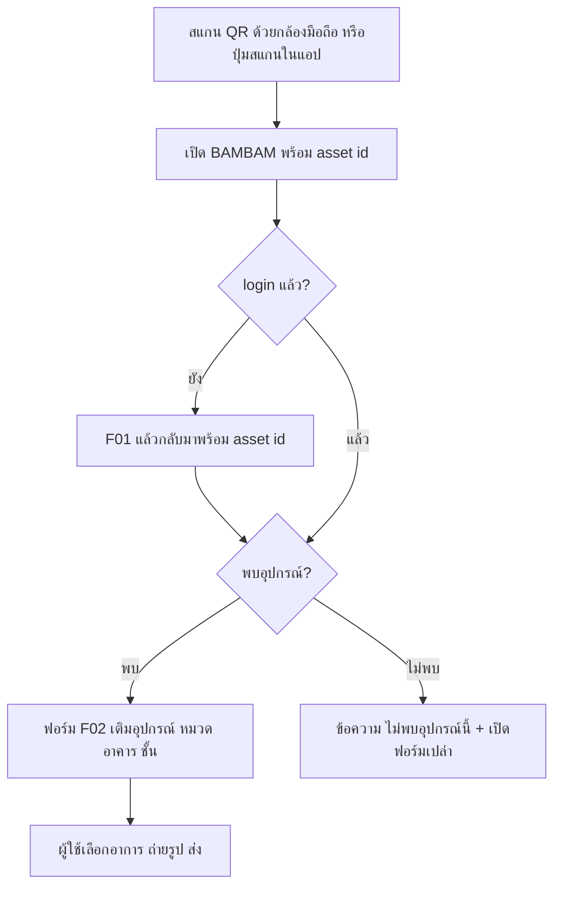
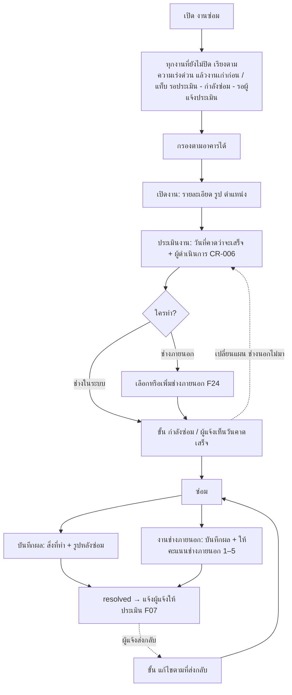
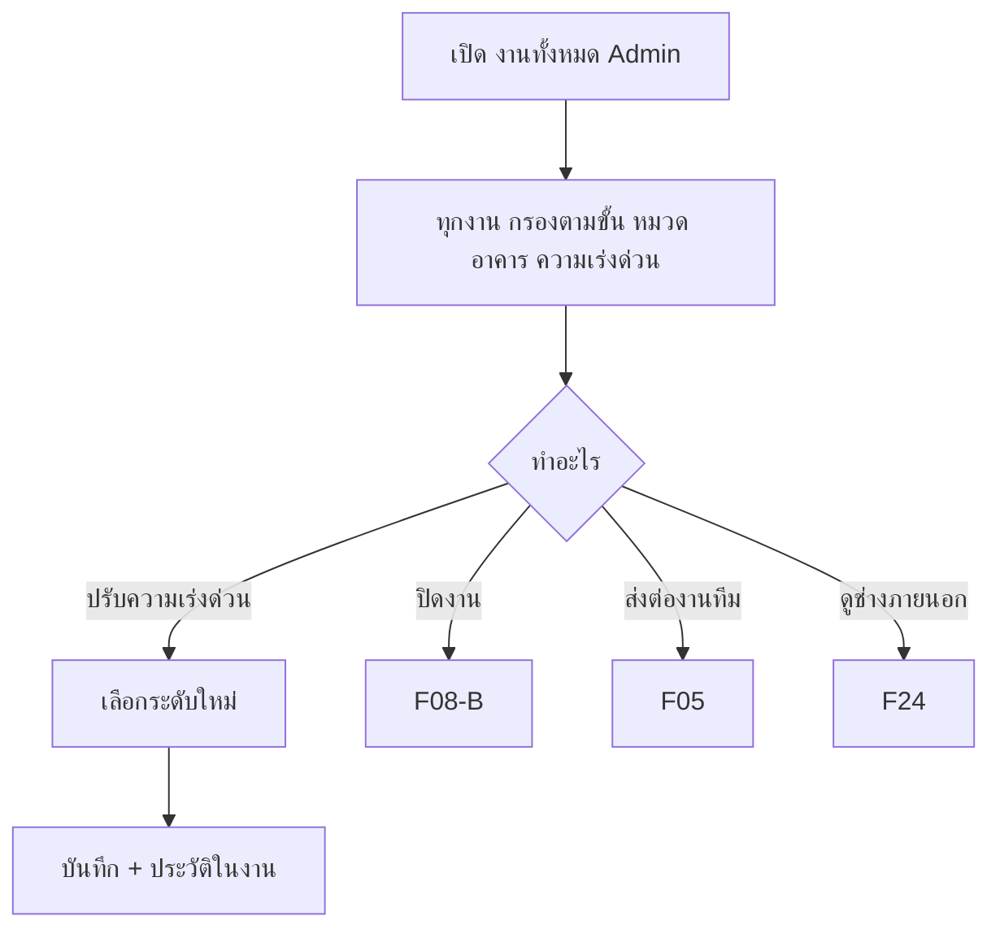
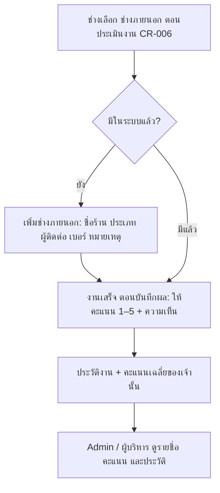

# ระบบแจ้งซ่อม — User flows

Status: APPROVED (2026-10-14) · CR-005 applied 2026-10-15

<!-- Written by Claude in /discovery (2026-10-14). Primary source: attachments/BAMBAM-User-Flow02.html (F01–F20).
     IDs from the source are kept. New flows start at F21. "Added by Claude" lists every addition so it can be reviewed.
     Changes after approval go through a CR. -->

## Ticket statuses (phase 1) (CR-005)

ช่างในระบบมีคนเดียว งานเข้าที่ช่างทันที ไม่มีคิว ไม่มีกดรับงาน (CR-005)

| Status | ขั้น (`step`) | ป้ายบนหน้าจอ | เข้าเมื่อ | ออกเมื่อ |
|---|---|---|---|---|
| `in_progress` | `awaiting_assessment` | กำลังดำเนินการ · รอช่างประเมิน | แจ้งซ่อม (F02), ส่งต่อจากทีม (F05) | ช่างประเมิน (F21), Admin ปิด |
| `in_progress` | `in_repair` | กำลังดำเนินการ · กำลังซ่อม (คาดว่าเสร็จ {วันที่}; ผู้ดำเนินการ CR-006) | ช่างประเมิน (F21) | ช่างบันทึกผล, Admin ปิด |
| `in_progress` | `reworking` | กำลังดำเนินการ · แก้ไขตามที่ส่งกลับ | ผู้แจ้งส่งกลับ (F07) | ช่างบันทึกผล, Admin ปิด |
| `resolved` | `awaiting_rating` | ซ่อมเสร็จ รอประเมิน | ช่างบันทึกผล (F21) | ผู้แจ้งประเมิน / ส่งกลับ, ปิดอัตโนมัติ 3 วัน, Admin ปิด |
| `closed` | `closed` | ปิดงานแล้ว | ประเมิน (F07), ทีมทำเอง (F04), ปิดอัตโนมัติ, Admin ปิด | ส่งต่อช่าง (F05, เฉพาะงานทีม) |

`closed_reason`: `confirmed` · `auto_closed` · `team_handled` · `admin_closed`. สถานะ `new` ถูกตัดออก (CR-005).
Later (F09): waiting_parts / approval, SLA, escalation.

ความคืบหน้าเดินหน้าอย่างเดียว: ส่งกลับ = เพิ่ม event ใหม่และขั้น "ส่งกลับให้แก้ → แก้ไขเสร็จ" ต่อท้าย ไม่ย้อนกลับไปขั้นเดิม (CR-005)

```mermaid
stateDiagram-v2
  [*] --> awaiting_assessment: แจ้งซ่อม (F02)
  [*] --> closed: ทีมทำเอง (F04)
  awaiting_assessment --> in_repair: ช่างประเมิน วันคาดเสร็จ (F21)
  in_repair --> awaiting_rating: ช่างบันทึกผล + รูป + ผู้ดำเนินการ (F21)
  awaiting_rating --> reworking: ผู้แจ้งส่งกลับ (F07)
  reworking --> awaiting_rating: ช่างบันทึกผลอีกครั้ง
  awaiting_rating --> closed: ผู้แจ้งให้ดาว (F07) / ครบ 3 วัน
  closed --> awaiting_assessment: ส่งต่อช่าง เฉพาะงานทีม (F05)
  awaiting_assessment --> closed: Admin ปิด (F08-B)
  in_repair --> closed: Admin ปิด
  reworking --> closed: Admin ปิด
```

## Flow index

| ID | Flow | Actor | Phase | Screens (draft) |
|---|---|---|---|---|
| F01 | เข้าสู่ระบบผ่าน SSO และโปรไฟล์ | ทุก role | 1 | S01 เข้าสู่ระบบ, S02 หน้าแรก, S14 โปรไฟล์ |
| F01-B | สลับบทบาท (dev/UAT) | ผู้ทดสอบ | 1 | S15 ตัวสลับบทบาท |
| F02 | แจ้งซ่อม | ทุก role | 1 | S03 ฟอร์มแจ้งซ่อม, S05 แจ้งสำเร็จ |
| F03 | ตรวจงานซ้ำ → ติดตามเคสเดิม | ทุก role | 1 | S04 พบงานซ้ำ |
| F04 | งานที่ทีมดำเนินการเอง | หัวหน้าแม่บ้าน/รปภ. | 1 | S03 (ตัวเลือกทีมทำเอง) |
| F05 | ส่งต่องานทีมให้ช่าง | หัวหน้าทีม, Admin | 1 | S07 รายละเอียดงาน |
| F06 | ติดตามงานและประวัติ | ทุก role | 1 | S06 ติดตามงานซ่อม (CR-003), S07 รายละเอียดงาน |
| F07 | ประเมิน (ให้ดาว) หรือส่งกลับให้แก้ (CR-005) | ผู้แจ้ง | 1 | S07, S08 ประเมินงาน |
| F08-B | Admin ปิด Ticket ได้ทุกงาน | Admin | 1 | S11 งานทั้งหมด (Admin), S07 |
| F13-B | สแกน QR ที่อุปกรณ์ → เติมฟอร์ม | ทุก role | 1 | S16 สแกน QR → S03 |
| F19-B | แจ้งเตือนเฉพาะตัว (กระดิ่ง) | ทุก role | 1 | S13 แจ้งเตือน |
| F21 | งานช่าง: ประเมิน → ซ่อม (เอง / จ้างช่างนอก) → บันทึกผล (CR-005) | ช่างเทคนิค (คนเดียว) | 1 | S09 งานซ่อม, S17 ประเมินงาน, S10 บันทึกผลซ่อม |
| F22 | Admin ดูทุกงานและปรับความเร่งด่วน (CR-005: ไม่มีจัดลำดับคิว) | Admin (ผู้บริหาร: ดูอย่างเดียว) | 1 | S11 งานทั้งหมด (Admin) |
| F24 | ช่างภายนอก: ข้อมูล ประเภท คะแนน ประวัติงาน (CR-005) | ช่างเทคนิค (แก้), Admin / ผู้บริหาร (ดู) | 1 | S18 ช่างภายนอก, S10 |
| F23 | ภาพรวมอาคาร 3D | Admin, ผู้บริหาร | mockup ก่อน (D-010) | S12 ภาพรวมอาคาร |
| อื่นๆ | F08 ส่วนที่เหลือ, F09–F12, F13-A, F14–F18, F19-A, F20 | — | later | discovery รอบหลัง |

---

## F01 — เข้าสู่ระบบผ่าน SSO และโปรไฟล์

- **Actor:** ทุก role · **Trigger:** เปิด BAMBAM · **Outcome:** เข้าหน้าแรกตาม role ที่เก็บใน BAMBAM

```mermaid
flowchart TD
  A[เปิด BAMBAM] --> B{มี session?}
  B -- มี --> H[หน้าแรก ตาม role]
  B -- ไม่มี --> C[หน้าเข้าสู่ระบบ] --> D[กด เข้าสู่ระบบ] --> E[RMC SSO ยืนยันตัวตน]
  E --> F{token ผ่านการตรวจ?}
  F -- ไม่ผ่าน --> X[แสดงข้อผิดพลาด ลองใหม่]
  F -- ผ่าน --> G[อัปเดตข้อมูลผู้ใช้จาก claim / ผู้ใช้ใหม่ = employee] --> H
  H --> P[โปรไฟล์: ดูข้อมูลจาก SSO]
  H --> L[ออกจากระบบ] --> S[ล้าง session → End Session → หน้า signed-out]
```

**Steps**
1. ไม่มี session → หน้าเข้าสู่ระบบ (ไม่ redirect ไป SSO อัตโนมัติ)
2. กด "เข้าสู่ระบบ" → RMC SSO → กลับมาที่ callback → ตรวจ token ตาม `docs/shared/integrations/sso.md`
3. Upsert ผู้ใช้จาก claim, อ่าน role จาก BAMBAM (ผู้ใช้ใหม่ = `employee`) → หน้าแรก
4. โปรไฟล์: ชื่อ ตำแหน่ง ฝ่าย อีเมล รหัสพนักงาน role — อ่านอย่างเดียว
5. ออกจากระบบ → ล้าง session → End Session ของ SSO → หน้า "ออกจากระบบแล้ว" (มีปุ่มเข้าสู่ระบบอีกครั้ง)

**Edge cases**
| Case | What happens |
|---|---|
| SSO ปฏิเสธ / ผู้ใช้กดยกเลิก | กลับหน้าเข้าสู่ระบบ + "เข้าสู่ระบบไม่สำเร็จ กรุณาลองใหม่" |
| token ไม่ผ่านการตรวจ | เหมือนข้างบน + log warning (ไม่มี token/PII) |
| SSO ปิดปรับปรุง | หน้าปิดปรับปรุง (maintenance guard — ก่อน production) |
| session หมดอายุระหว่างใช้ | กลับหน้าเข้าสู่ระบบ แล้วกลับหน้าเดิมหลัง login |

**Business rules**
- BR-F01-1: role มาจาก BAMBAM ไม่ใช่ SSO; 1 role ต่อคน; ผู้ใช้ใหม่ = `employee` (D-003, D-004)
- BR-F01-2: phase 1 กำหนด role อื่นจากไฟล์ seed (หน้าจัดการผู้ใช้ F15 มาทีหลัง); ไม่มีหมวดงานของช่างแล้ว (CR-005)
- BR-F01-3: ข้อมูลโปรไฟล์อัปเดตจาก claim ทุกครั้งที่ login; ผู้ใช้แก้เองไม่ได้

**Added by Claude**
- กลับหน้าเดิมหลัง login เมื่อ session หมดอายุ
- ตัด "แก้ข้อมูลโปรไฟล์เสริม / ภาษา" ของเดิมออกจาก phase 1 (ภาษาอยู่ F19-A)

## F01-B — สลับบทบาท (dev/UAT เท่านั้น)

- **Actor:** ผู้ทดสอบใน dev/UAT · **Outcome:** เห็นแอปในฐานะผู้ใช้ตัวอย่างของ role ที่เลือก



**Business rules**
- BR-F01B-1: มีเฉพาะเมื่อไม่ใช่ production (D-005); production ไม่มีทั้งปุ่มและ endpoint
- BR-F01B-2: สลับเป็นผู้ใช้ตัวอย่าง 1 คนต่อ role แต่ละคนมีงานตัวอย่างของตัวเอง; ไม่แก้ role ของบัญชีจริง
- BR-F01B-3: ทุกครั้งที่สลับบันทึก audit log

## F02 — แจ้งซ่อม

- **Actor:** ทุก role · **Trigger:** กด "แจ้งซ่อม" (หน้าแรก/เมนู) หรือสแกน QR (F13-B) · **Outcome:** ได้เลข Ticket, งานถึงช่างทันที สถานะ "กำลังดำเนินการ · รอช่างประเมิน" (CR-005)



**Steps**
1. เปิดฟอร์ม (มือถือ: ทีละขั้นเต็มจอ; desktop: หน้าเดียว — รายละเอียดใน ui-spec)
2. เลือกหมวดงาน และอาการ (เลือกได้หลายข้อ)
3. เลือกอาคาร / ชั้น และจุดที่เกิด (ข้อความสั้น)
4. รายละเอียด + แนบรูป (ถ่ายจากกล้องหรือเลือกจากเครื่อง)
5. เลือกความเร่งด่วน: ฉุกเฉิน / สูง / ปกติ / ต่ำ (ค่าเริ่มต้น ปกติ)
6. กด "ส่ง" → ตรวจงานซ้ำ (F03) → (หัวหน้าทีม) ทีมทำเอง? (F04) → สร้าง Ticket → หน้าแจ้งสำเร็จ

**Edge cases**
| Case | What happens |
|---|---|
| กรอกไม่ครบ | ข้อความใต้ช่องที่ขาด และไม่ส่ง |
| อัปโหลดรูปไม่สำเร็จ / ไฟล์ใหญ่ | ข้อความที่รูปนั้น ลองใหม่ได้ ข้อมูลอื่นไม่หาย |
| เน็ตหลุดตอนส่ง | "ส่งไม่สำเร็จ ลองอีกครั้ง" ข้อมูลในฟอร์มยังอยู่ |
| ออกจากฟอร์มกลางทาง | ถามยืนยันก่อนทิ้งข้อมูล |
| ยังไม่มีผู้ใช้ role ช่าง | ยังสร้างได้ Admin เห็นในงานทั้งหมด (Added by Claude, CR-005) |

**Business rules**
- BR-F02-1: ฟิลด์บังคับ: หมวด, อาการ ≥ 1, อาคาร, ชั้น, ความเร่งด่วน, **รูป ≥ 1** (approval 2026-10-14); สูงสุด 5 รูป (Added by Claude)
- BR-F02-2: ผู้แจ้งเลือกความเร่งด่วนเอง Admin ปรับได้ภายหลัง (D-007)
- BR-F02-3: Ticket ใหม่ = `in_progress` ขั้น `awaiting_assessment` ถึงช่างทันที ไม่มีคิว (CR-005)
- BR-F02-4: เลข Ticket ไม่ซ้ำ รูปแบบเริ่มต้น `RP-{ปี พ.ศ.}-{เลขรัน 6 หลัก}` เช่น `RP-2569-000123` เลขรันเริ่มใหม่ทุกปี (approval 2026-10-14)
- BR-F02-5: รูปแบบเลข Ticket **แก้ได้โดยไม่ต้องแก้โค้ด** (เก็บเป็นค่าตั้งค่าในระบบ: prefix, ปี พ.ศ./ค.ศ., จำนวนหลัก); เปลี่ยนแล้วมีผลกับงานใหม่เท่านั้น เลขเดิมไม่เปลี่ยน. Phase 1 แก้ผ่านค่าตั้งค่า, หน้าตั้งค่าสำหรับ Admin มาทีหลัง (approval 2026-10-14)

**Added by Claude**
- กรณีทิ้งฟอร์ม / เน็ตหลุด / อัปโหลดรูปไม่สำเร็จ
- แจ้งเตือนช่างเมื่อมีงานใหม่ (CR-005: ไม่มีหมวดของช่าง)
- ตัด "ระบบตั้ง Priority เมื่อเข้าเงื่อนไขฉุกเฉิน" ของเดิม แทนด้วย BR-F02-2 — ระบบไม่เลือกให้

## F03 — ตรวจงานซ้ำ → ติดตามเคสเดิม

- **Actor:** ผู้แจ้ง · **Trigger:** กดส่งใน F02 · **Outcome:** เป็นผู้ติดตามเคสเดิม หรือสร้าง Ticket ใหม่



**Business rules**
- BR-F03-1: "ซ้ำ" = สถานะ `in_progress` / `resolved` (CR-005) + อาคารและชั้นเดียวกัน + หมวดเดียวกัน (ตามไฟล์แนบ)
- BR-F03-2: ผู้แจ้งเลือกเอง: ติดตามเคสนี้ หรือ แจ้งใหม่ (kickoff 2026-10-14)
- BR-F03-3: ผู้ติดตามได้รับแจ้งเตือนเหมือนผู้แจ้ง แต่ประเมินงานไม่ได้ (ประเมินได้เฉพาะผู้แจ้ง)

**Added by Claude**
- ข้อความ/รูปของผู้ติดตามถูกเพิ่มเป็นกิจกรรมในเคสเดิม
- BR-F03-3; พบหลายเคส → แสดงทั้งหมด ล่าสุดก่อน

## F04 — งานที่ทีมดำเนินการเอง

- **Actor:** หัวหน้าแม่บ้าน / หัวหน้ารปภ. · **Outcome:** Ticket `closed` (`team_handled`) ทันที ไม่มีแบบประเมิน

```mermaid
flowchart TD
  A[หัวหน้าทีมเปิดฟอร์มแจ้งซ่อม] --> B[กรอกข้อมูลงานตาม F02]
  B --> C{ทีมแก้เองได้?}
  C -- ไม่ได้ --> Q[ส่งตามปกติ → ถึงช่าง (CR-005)]
  C -- ได้ --> D[เลือก ทีมดำเนินการเอง + บันทึกสิ่งที่ทำ + รูปหลังทำ] --> E[ส่ง]
  E --> F[Ticket closed: team_handled] --> G[ภายหลังต้องใช้ช่าง → F05]
```

**Business rules**
- BR-F04-1: ตัวเลือก "ทีมดำเนินการเอง" เห็นเฉพาะ `housekeeper_lead`, `security_lead`
- BR-F04-2: ต้องกรอก "สิ่งที่ทีมทำ" และ**รูปหลังทำ ≥ 1** (approval 2026-10-14)
- BR-F04-3: ไม่มีแบบประเมิน ไม่ส่งถึงช่าง แต่ยังผ่านการตรวจงานซ้ำ (F03) ก่อน

## F05 — ส่งต่องานทีมให้ช่าง

- **Actor:** หัวหน้าทีมเจ้าของงาน หรือ Admin · **Outcome:** Ticket **เดิม** ส่งถึงช่าง (`in_progress` รอช่างประเมิน, CR-005) เลขและประวัติเดิม

```mermaid
flowchart TD
  A1[หัวหน้าทีมเปิดงานของตัวเองใน ติดตามงานซ่อม (CR-003)] --> B[กด ส่งต่อให้ช่าง + เหตุผล]
  A2[Admin เปิดงานทีมในงานทั้งหมด] --> B
  B --> C[Ticket เดิม → in_progress รอช่างประเมิน / บันทึกกิจกรรม ส่งต่อจากทีม (CR-005)] --> D[ช่างประเมินตาม F21]
```

**Business rules**
- BR-F05-1: ใช้ได้เฉพาะ Ticket `closed` ที่ `closed_reason = team_handled`
- BR-F05-2: หัวหน้าทีมส่งต่อได้เฉพาะงานที่ตัวเองบันทึก; Admin ส่งได้ทุกงานทีม (แก้ gap ในไฟล์แนบ)
- BR-F05-3: ไม่สร้าง Ticket ใหม่ (ข้อกำหนด 13 ต.ค. 2569)

**Added by Claude**
- สถานะหลังส่งต่อ = `in_progress` ขั้นรอช่างประเมิน แทน `waiting_assignment` ของไฟล์แนบ (D-006, CR-005)
- เหตุผลการส่งต่อ (บังคับ)

## F06 — ติดตามงานและประวัติ

- **Actor:** ทุก role · **Outcome:** เห็นสถานะ ไปต่อที่ประเมินงาน / ส่งต่อ

```mermaid
flowchart TD
  A[เปิด ติดตามงานซ่อม (CR-003)] --> B[รายการ: งานที่แจ้ง + งานที่ติดตาม / กลุ่ม รอประเมิน - กำลังดำเนินการ - ปิดแล้ว (CR-002, CR-005)]
  B --> C[ค้นเลขงาน / สถานที่ กรองสถานะ ช่วงวัน] --> D[เปิดรายละเอียด]
  D --> E[Timeline: แจ้ง → ช่างประเมิน วันคาดเสร็จ → บันทึกผล ผู้ดำเนินการ → ประเมิน / ปิด / รูปก่อน-หลัง (CR-005)]
  E --> F{สถานะ / ผู้ดู}
  F -- resolved และเป็นผู้แจ้ง --> G[F07 ประเมินงาน]
  F -- งานทีม และเป็นเจ้าของ --> H[F05 ส่งต่อช่าง]
  F -- อื่นๆ --> I[ดูความคืบหน้า]
```

**Business rules**
- BR-F06-1: พนักงาน/หัวหน้าทีม เห็นงานที่ตัวเองแจ้งหรือติดตาม (แก้ Finding 02 ในไฟล์แนบ); ช่าง Admin และผู้บริหารเห็นทุกงาน (approval 2026-10-14, CR-005: ช่างคนเดียวเห็นทุกงาน)
- BR-F06-2: งาน `resolved` ของผู้แจ้งอยู่บนสุด พร้อมป้าย "รอคุณประเมิน" (CR-005)
- BR-F06-4: ผู้แจ้งเห็นวันที่คาดว่าจะเสร็จ และ "ดำเนินการโดยช่างภายนอก · {ประเภท}" แต่ไม่เห็นชื่อ เบอร์ หรือคะแนนของช่างภายนอก (CR-005)
- BR-F06-3: Timeline แสดงทุกการเปลี่ยนสถานะ ใครทำ เมื่อไร (Added by Claude)

**Edge cases**
| Case | What happens |
|---|---|
| ยังไม่เคยแจ้ง | สถานะว่าง + มาสคอต + ปุ่ม "แจ้งซ่อม" |
| เปิดงานที่ไม่มีสิทธิ์ (ลิงก์ตรง) | หน้าไม่มีสิทธิ์ |
| โหลดไม่สำเร็จ | ข้อความผิดพลาด + ลองใหม่ |

## F07 — ประเมิน (ให้ดาว) หรือส่งกลับให้แก้ (CR-005)

- **Actor:** ผู้แจ้งเท่านั้น · **Trigger:** งาน `resolved` (ซ่อมเสร็จ รอประเมิน) · **Outcome:** `closed` หรือกลับไปแก้กับช่าง



**Business rules**
- BR-F07-1: ประเมิน/ส่งกลับได้เฉพาะผู้แจ้ง (ตรวจที่ backend — แก้ Finding 02)
- BR-F07-2: ประเมิน = **ดาว 1–5 บังคับ** ความเห็นไม่บังคับ — ตั้งใจให้ได้คะแนนจากพนักงานมากที่สุด (CR-005)
- BR-F07-3: ส่งกลับ → เหตุผลบังคับ รูปไม่บังคับ; สร้าง event ใหม่และเดินหน้าเป็นขั้น "แก้ไขตามที่ส่งกลับ" กับช่าง ไม่ย้อนกลับไปขั้นเดิม ไม่ต้องประเมินใหม่ (CR-005; แทน CR-001 การจองงาน)
- BR-F07-4: ไม่ประเมินภายใน 3 วันหลัง `resolved` → ปิดอัตโนมัติ (`auto_closed`) (kickoff) — นับ **วันปฏิทิน** 3 × 24 ชม. นับจากเวลาที่เป็น `resolved` ล่าสุด (approval 2026-10-14)
- BR-F07-5: งานทีมทำเอง (F04) ไม่มีขั้นนี้
- BR-F07-6: Admin ปิดได้โดยไม่รอขั้นนี้ (F08-B)

**Added by Claude**
- แจ้งเตือนผู้แจ้งก่อนปิดอัตโนมัติ 1 วัน
- ส่งกลับได้ไม่จำกัดครั้ง แสดงจำนวนครั้งในงาน

## F08-B — Admin ปิด Ticket ได้ทุกงาน

- **Actor:** Admin · **Outcome:** `closed` (`admin_closed`) จากสถานะใดก็ได้ที่ยังไม่ปิด

1. เลือก Ticket → กด "ปิดงาน" → ใส่เหตุผล → ยืนยันในกล่องยืนยัน
2. แจ้งเตือนผู้แจ้ง ผู้ติดตาม และช่าง

- BR-F08B-1: ไม่จำกัดผู้แจ้ง/ผู้รับผิดชอบ, ไม่ต้องผ่าน `resolved` (ข้อกำหนด 13 ต.ค. 2569)
- **Added by Claude:** เหตุผลบังคับ, ยืนยันก่อนปิด, แจ้งเตือนผู้เกี่ยวข้อง

## F13-B — สแกน QR ที่อุปกรณ์ → เติมฟอร์ม

- **Actor:** ทุก role · **Outcome:** ฟอร์ม F02 ที่กรอกอุปกรณ์ หมวด อาคาร ชั้น ไว้ให้แล้ว



- BR-F13B-1: ข้อมูลอุปกรณ์ phase 1 มาจากไฟล์ seed ✏️ ขอไฟล์รายการอุปกรณ์ (POC เดิมใช้ `bam-assets.csv`)
- BR-F13B-2: ค่าที่เติมให้ ผู้ใช้แก้ได้
- **Added by Claude:** asset id ต้องอยู่รอดหลัง login (ตอบคำถามในไฟล์แนบ), กรณีไม่พบอุปกรณ์
- Open: ป้าย QR (F13-A) phase 1 ทำอย่างไร — ตัดสินใน `/stage-plan` (ไม่กระทบหน้าจอผู้ใช้)

## F19-B — แจ้งเตือนเฉพาะตัว (กระดิ่ง)

| เหตุการณ์ | ใครได้รับ |
|---|---|
| งานใหม่ | ช่าง (CR-005) |
| ช่างประเมิน / เลื่อนวันคาดเสร็จ | ผู้แจ้ง + ผู้ติดตาม (CR-005) |
| ซ่อมเสร็จ รอประเมิน | ผู้แจ้ง (+ ผู้ติดตาม เพื่อทราบ) |
| ผู้แจ้งส่งกลับให้แก้ | ช่าง |
| เตือนก่อนปิดอัตโนมัติ / ปิดอัตโนมัติ | ผู้แจ้ง |
| Admin ปิดงาน | ผู้แจ้ง + ผู้ติดตาม + ช่าง |

- BR-F19B-1: แจ้งเตือนในแอปเท่านั้น (ไม่มี LINE/อีเมลใน phase 1); แต่ละคนเห็นเฉพาะของตัวเอง (แก้ Finding 08) (kickoff)
- BR-F19B-2: กดรายการ → ไปหน้ารายละเอียดงาน; มีตัวเลขยังไม่อ่านบนกระดิ่ง
- **Added by Claude:** ตารางผู้รับทั้งหมด

## F21 — งานช่าง: ประเมิน → ซ่อม → บันทึกผล (CR-005, แทน "คิวงานช่าง" D-006)

- **Actor:** ช่างเทคนิค (ช่างในระบบมีคนเดียว) · **Outcome:** งาน `resolved` พร้อมผลซ่อม และคะแนนช่างภายนอกถ้าจ้าง



**Business rules**
- BR-F21-1: ช่างเห็นทุกงานที่ยังไม่ปิด เรียง ฉุกเฉิน → สูง → ปกติ → ต่ำ แล้วงานเก่าก่อน; ไม่มีกดรับงาน ไม่จำกัดจำนวนงานที่ทำพร้อมกัน ไม่มีหมวดของช่าง (CR-005)
- BR-F21-2: ประเมินงาน = **วันที่คาดว่าจะเสร็จ** (วันนี้หรือหลังจากนี้) + **ผู้ดำเนินการ** (ช่างในระบบ / ช่างภายนอก; ช่างภายนอกต้องเลือกเจ้าหรือเพิ่มใหม่) ทำก่อนบันทึกผล; แก้ได้ระหว่างทำงาน (เช่น ช่างนอกไม่มา) ทุกครั้งบันทึกใน timeline; เปลี่ยนช่างนอก → คะแนนของเจ้าเดิมถูกล้าง (CR-005, CR-006)
- BR-F21-3: ช่างที่ประเมินหรือบันทึกผลเป็น "ช่างผู้รับผิดชอบ" ของงาน (CR-005)
- BR-F21-4: บันทึกผล: "สิ่งที่ทำ" และ**รูปหลังซ่อม ≥ 1** บังคับ (approval 2026-10-14); งานช่างภายนอกต้องให้คะแนนช่างภายนอกด้วย (BR-F24-3); ผู้ดำเนินการกำหนดไว้แล้วตอนประเมิน ไม่เลือกซ้ำ (CR-006); ค่าใช้จ่ายมาทีหลัง (F10)
- BR-F21-5: ผลซ่อมล่าสุดแสดงในการ์ดผลการซ่อม ผลครั้งก่อนอยู่ใน timeline (CR-005)
- BR-F21-6: มีตัวกรองตามอาคาร (เลือกได้ "ทุกอาคาร") (CR-001)
- BR-F21-7: Admin ปิดงานได้ทุกสถานะ (F08-B)

**Edge cases**
| Case | What happens |
|---|---|
| ไม่มีงาน | สถานะว่างของแท็บนั้น |
| ตัวกรองอาคารแล้วไม่มีงาน | "ไม่มีงานในอาคารนี้" + ปุ่มดูทุกอาคาร (CR-001) |
| กดบันทึกผลก่อนประเมิน | ปุ่มปิด + "ประเมินงาน (วันที่คาดว่าจะเสร็จ และผู้ดำเนินการ) ก่อนบันทึกผล"; backend ปฏิเสธ (CR-005, CR-006) |
| ช่างภายนอกที่เลือกถูกปิดใช้งานระหว่างกรอก | "ไม่พบช่างภายนอกนี้ หรือถูกปิดใช้งานแล้ว" เลือกใหม่ (CR-005) |
| Admin ปิดงานระหว่างกรอกผล | "งานนี้ถูกปิดไปแล้ว" |
| เลยวันคาดเสร็จ | รายการของช่างแสดง "เลยกำหนด" สีแดง (Added by Claude, CR-005) |

## F22 — Admin ดูทุกงานและปรับความเร่งด่วน (D-007, CR-005: ตัดการจัดลำดับคิว)

- **Actor:** Admin (desktop เป็นหลัก) · **Outcome:** ความเร่งด่วนที่ช่างเห็นเปลี่ยนทันที



**Business rules**
- BR-F22-1: ลำดับในรายการของช่าง: ฉุกเฉิน → สูง → ปกติ → ต่ำ แล้วตามเวลาแจ้ง (เก่าก่อน)
- BR-F22-3: ทุกการปรับความเร่งด่วนบันทึก audit (ใคร เมื่อไร จาก → ไป) (D-006)
- BR-F22-6: ผู้บริหารเห็นหน้าเดียวกับ Admin แต่**อ่านอย่างเดียว** (approval 2026-10-14)
- ตัดออก (CR-005): BR-F22-2 ลากจัดลำดับ, BR-F22-4, BR-F22-5 — ไม่มีคิวแล้ว

## F24 — ช่างภายนอก (ใหม่, CR-005)

- **Actor:** ช่างเทคนิค (เพิ่ม/แก้ไข ให้คะแนน), Admin และผู้บริหาร (ดู) · **Outcome:** มีประวัติงานและคะแนนของช่างภายนอกแต่ละเจ้า



**Business rules**
- BR-F24-1: ช่างในระบบเป็นคนเพิ่ม/แก้ข้อมูลช่างภายนอก; ฟิลด์: ชื่อร้าน/บริษัท (บังคับ), ประเภท ≥ 1 (บังคับ, หลายประเภทได้), ผู้ติดต่อ, เบอร์โทร, หมายเหตุ; ไม่ลบ — ปิดใช้งานแทน ประวัติยังอยู่
- BR-F24-2: ประเภทช่างภายนอก: เลือกจากรายการ หรือช่างเพิ่มใหม่ได้เอง; ชื่อซ้ำ (ไม่สนตัวพิมพ์) ใช้ประเภทเดิม
- BR-F24-3: ช่างภายนอกถูกเลือกตอนประเมินงาน (CR-006); งานที่ทำโดยช่างภายนอก ช่างในระบบ**ต้องให้คะแนนช่างภายนอก 1–5** ตอนบันทึกผล (ถ้ายังไม่มีคะแนนในงานนั้น) ความเห็นไม่บังคับ; หนึ่งงานมีช่างภายนอกหนึ่งเจ้า (ล่าสุด)
- BR-F24-4: ชื่อ เบอร์ และคะแนนของช่างภายนอก เห็นเฉพาะช่าง Admin และผู้บริหาร; ผู้แจ้งเห็นแค่ "ดำเนินการโดยช่างภายนอก · {ประเภท}"
- BR-F24-5: Admin และผู้บริหารเห็นรายชื่อ จำนวนงาน คะแนนเฉลี่ย และประวัติงานรายเจ้า (งาน วันที่เสร็จ คะแนนจากช่าง คะแนนจากผู้แจ้ง)

**Added by Claude**
- เพิ่มช่างภายนอกใหม่ได้จากกล่องประเมินงานโดยไม่ต้องออกจากหน้า
- ค่าใช้จ่ายการจ้างมาพร้อม F10 (later)

## F23 — ภาพรวมอาคาร 3D (ใหม่, D-010 — mockup ก่อน)

- **Actor:** Admin, ผู้บริหาร (ดูอย่างเดียว) · **Outcome:** เห็นว่าชั้นไหน/จุดไหนมีงานค้าง

1. เปิดหน้าภาพรวม → โมเดล 3D คร่าวของสำนักงานใหญ่ (อ้างอิง `attachments/cpac-building.png`: อาคารหลักประมาณ 6–7 ชั้น + อาคารเตี้ยด้านหลัง)
2. หมุดบนแต่ละชั้นแสดงจำนวนงานที่ยังไม่ปิด สีตามความเร่งด่วนสูงสุดในชั้นนั้น
3. กดชั้น → รายการงานในชั้นนั้น; กดงาน → รายละเอียด (S07)

- Open (ไม่บล็อก): จำนวนชั้นจริง, อาคารด้านหลัง, ชื่อชั้น — ผู้ใช้จะแก้รายละเอียดภายหลัง; build อยู่ stage ไหนตัดสินใน `/stage-plan`

---

## Later flows (from the attachment, not detailed yet)

F08 ศูนย์จัดการงานส่วนอื่น · F09 สถานะและ SLA · F10 ค่าใช้จ่าย · F11 Insights · F12 คลังอุปกรณ์ · F13-A สร้างป้าย QR · F14 ผังอาคาร 2D/3D · F15 จัดการผู้ใช้ / role (ย้ายไปโมดูล `settings`, D-046; หมวดของช่างตัดออก CR-005) · F16 แชท · F17 คำขอจัดห้อง (อาจย้ายไป room_booking) · F18 บริการภายนอก (อาจถูกแทนด้วย car_booking / room_booking) · F19-A ภาษา/ธีม · F20 ส่วนที่ยังไม่เชื่อม

## Open questions (summary)

ข้อมูลจริงสำหรับไฟล์ seed (ต้องมีก่อน mockup ใช้ข้อมูลจริงได้; ระหว่างนี้ใช้ข้อมูลตัวอย่างที่ระบุว่าเป็นตัวอย่าง): หมวดงาน + อาการ, ผู้ใช้ role ช่าง (คนเดียว, CR-005), อาคาร / ชั้น, รายการอุปกรณ์สำหรับ QR, ประเภทช่างภายนอกตั้งต้น (ถ้ามี)
