# ระบบแจ้งซ่อม — User flows

Status: APPROVED (2026-10-14)

<!-- Written by Claude in /discovery (2026-10-14). Primary source: attachments/BAMBAM-User-Flow02.html (F01–F20).
     IDs from the source are kept. New flows start at F21. "Added by Claude" lists every addition so it can be reviewed.
     Changes after approval go through a CR. -->

## Ticket statuses (phase 1)

| Status | ป้ายบนหน้าจอ | เข้าเมื่อ | ออกเมื่อ |
|---|---|---|---|
| `new` | รอช่างรับงาน | แจ้งซ่อม (F02), ส่งต่อจากทีม (F05), ช่างคืนงาน (F21), ผู้แจ้งส่งกลับขณะช่างคนเดิมไม่ว่าง — จองไว้ให้ช่างคนนั้น (F07) (CR-001) | ช่างรับงาน / ช่างเริ่มงานที่จองไว้, Admin ปิด |
| `in_progress` | ช่างกำลังดำเนินการ | ช่างรับงาน (F21), ผู้แจ้งส่งกลับให้แก้ (F07) | ช่างบันทึกผล, ช่างคืนงาน, Admin ปิด |
| `resolved` | ซ่อมเสร็จ รอตรวจรับ | ช่างบันทึกผล (F21) | ผู้แจ้งตรวจรับ / ส่งกลับ, ปิดอัตโนมัติ 3 วัน, Admin ปิด |
| `closed` | ปิดงานแล้ว | ตรวจรับ (F07), ทีมทำเอง (F04), ปิดอัตโนมัติ, Admin ปิด (F08-B) | ส่งต่อช่าง (F05, เฉพาะงานทีม) |

`closed_reason`: `confirmed` · `auto_closed` · `team_handled` · `admin_closed`.
Later (F09): waiting_parts / external / approval, SLA, escalation.

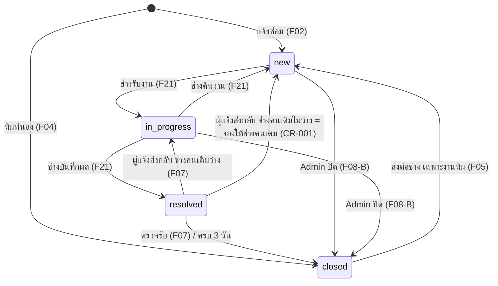

## Flow index

| ID | Flow | Actor | Phase | Screens (draft) |
|---|---|---|---|---|
| F01 | เข้าสู่ระบบผ่าน SSO และโปรไฟล์ | ทุก role | 1 | S01 เข้าสู่ระบบ, S02 หน้าแรก, S14 โปรไฟล์ |
| F01-B | สลับบทบาท (dev/UAT) | ผู้ทดสอบ | 1 | S15 ตัวสลับบทบาท |
| F02 | แจ้งซ่อม | ทุก role | 1 | S03 ฟอร์มแจ้งซ่อม, S05 แจ้งสำเร็จ |
| F03 | ตรวจงานซ้ำ → ติดตามเคสเดิม | ทุก role | 1 | S04 พบงานซ้ำ |
| F04 | งานที่ทีมดำเนินการเอง | หัวหน้าแม่บ้าน/รปภ. | 1 | S03 (ตัวเลือกทีมทำเอง) |
| F05 | ส่งต่องานทีมให้ช่าง | หัวหน้าทีม, Admin | 1 | S07 รายละเอียดงาน |
| F06 | ติดตามงานและประวัติ | ทุก role | 1 | S06 งานของฉัน, S07 รายละเอียดงาน |
| F07 | ตรวจรับ ให้คะแนน หรือส่งกลับให้แก้ | ผู้แจ้ง | 1 | S07, S08 ตรวจรับ |
| F08-B | Admin ปิด Ticket ได้ทุกงาน | Admin | 1 | S11 คิวงาน (Admin), S07 |
| F13-B | สแกน QR ที่อุปกรณ์ → เติมฟอร์ม | ทุก role | 1 | S16 สแกน QR → S03 |
| F19-B | แจ้งเตือนเฉพาะตัว (กระดิ่ง) | ทุก role | 1 | S13 แจ้งเตือน |
| F21 | คิวงานช่าง: รับงาน → บันทึกผล / คืนงาน | ช่างเทคนิค | 1 | S09 คิวงาน, S10 บันทึกผลซ่อม |
| F22 | Admin จัดลำดับคิวและปรับความเร่งด่วน | Admin (ผู้บริหาร: ดูอย่างเดียว) | 1 | S11 คิวงาน (Admin) |
| F23 | ภาพรวมอาคาร 3D | Admin, ผู้บริหาร | mockup ก่อน (D-010) | S12 ภาพรวมอาคาร |
| อื่นๆ | F08 ส่วนที่เหลือ, F09–F12, F13-A, F14–F18, F19-A, F20 | — | later | discovery รอบหลัง |

---

## F01 — เข้าสู่ระบบผ่าน SSO และโปรไฟล์

- **Actor:** ทุก role · **Trigger:** เปิด BAMBAM · **Outcome:** เข้าหน้าแรกตาม role ที่เก็บใน BAMBAM

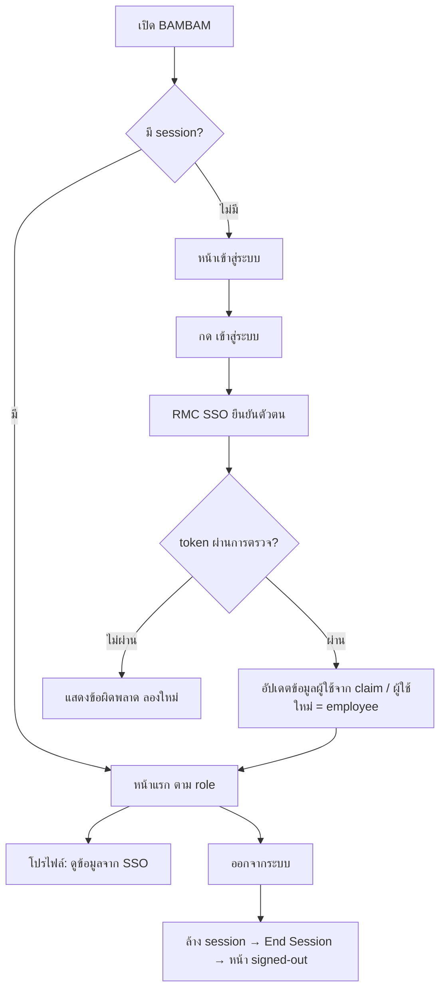

**Steps**
1. ไม่มี session → หน้าเข้าสู่ระบบ (ไม่ redirect ไป SSO อัตโนมัติ)
2. กด "เข้าสู่ระบบ" → RMC SSO → กลับมาที่ callback → ตรวจ token ตาม `docs/shared/integrations/sso.md`
3. Upsert ผู้ใช้จาก claim, อ่าน role จาก BAMBAM (ผู้ใช้ใหม่ = `employee`) → หน้าแรก
4. โปรไฟล์: ชื่อ ตำแหน่ง ฝ่าย อีเมล รหัสพนักงาน role — อ่านอย่างเดียว
5. ออกจากระบบ → ล้าง session → End Session ของ SSO → หน้า "ออกจากระบบแล้ว" (มีปุ่มเข้าสู่ระบบอีกครั้ง)

**Edge cases**
| Case | What happens |
|---|---|
| SSO ปฏิเสธ / ผู้ใช้กดยกเลิก | กลับหน้าเข้าสู่ระบบ + "เข้าสู่ระบบไม่สำเร็จ กรุณาลองใหม่" |
| token ไม่ผ่านการตรวจ | เหมือนข้างบน + log warning (ไม่มี token/PII) |
| SSO ปิดปรับปรุง | หน้าปิดปรับปรุง (maintenance guard — ก่อน production) |
| session หมดอายุระหว่างใช้ | กลับหน้าเข้าสู่ระบบ แล้วกลับหน้าเดิมหลัง login |

**Business rules**
- BR-F01-1: role มาจาก BAMBAM ไม่ใช่ SSO; 1 role ต่อคน; ผู้ใช้ใหม่ = `employee` (D-003, D-004)
- BR-F01-2: phase 1 กำหนด role อื่น และหมวดงานของช่าง จากไฟล์ seed (หน้าจัดการผู้ใช้ F15 มาทีหลัง)
- BR-F01-3: ข้อมูลโปรไฟล์อัปเดตจาก claim ทุกครั้งที่ login; ผู้ใช้แก้เองไม่ได้

**Added by Claude**
- กลับหน้าเดิมหลัง login เมื่อ session หมดอายุ
- ตัด "แก้ข้อมูลโปรไฟล์เสริม / ภาษา" ของเดิมออกจาก phase 1 (ภาษาอยู่ F19-A)

## F01-B — สลับบทบาท (dev/UAT เท่านั้น)

- **Actor:** ผู้ทดสอบใน dev/UAT · **Outcome:** เห็นแอปในฐานะผู้ใช้ตัวอย่างของ role ที่เลือก

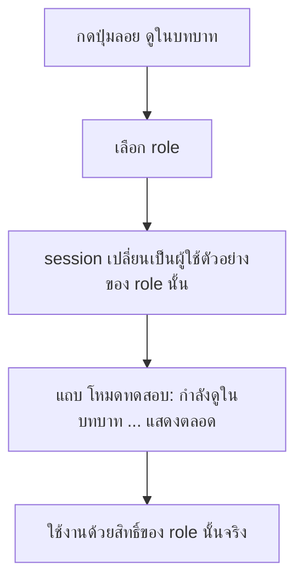

**Business rules**
- BR-F01B-1: มีเฉพาะเมื่อไม่ใช่ production (D-005); production ไม่มีทั้งปุ่มและ endpoint
- BR-F01B-2: สลับเป็นผู้ใช้ตัวอย่าง 1 คนต่อ role แต่ละคนมีงานตัวอย่างของตัวเอง; ไม่แก้ role ของบัญชีจริง
- BR-F01B-3: ทุกครั้งที่สลับบันทึก audit log

## F02 — แจ้งซ่อม

- **Actor:** ทุก role · **Trigger:** กด "แจ้งซ่อม" (หน้าแรก/เมนู) หรือสแกน QR (F13-B) · **Outcome:** ได้เลข Ticket, งานเข้าคิวช่างของหมวดนั้น

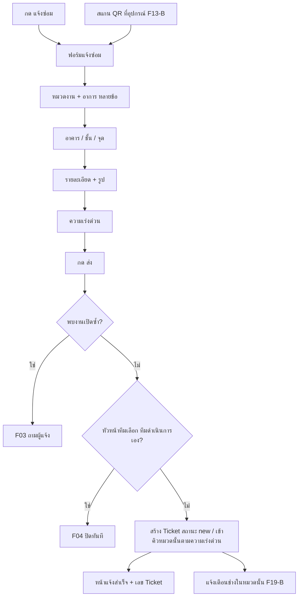

**Steps**
1. เปิดฟอร์ม (มือถือ: ทีละขั้นเต็มจอ; desktop: หน้าเดียว — รายละเอียดใน ui-spec)
2. เลือกหมวดงาน และอาการ (เลือกได้หลายข้อ)
3. เลือกอาคาร / ชั้น และจุดที่เกิด (ข้อความสั้น)
4. รายละเอียด + แนบรูป (ถ่ายจากกล้องหรือเลือกจากเครื่อง)
5. เลือกความเร่งด่วน: ฉุกเฉิน / สูง / ปกติ / ต่ำ (ค่าเริ่มต้น ปกติ)
6. กด "ส่ง" → ตรวจงานซ้ำ (F03) → (หัวหน้าทีม) ทีมทำเอง? (F04) → สร้าง Ticket → หน้าแจ้งสำเร็จ

**Edge cases**
| Case | What happens |
|---|---|
| กรอกไม่ครบ | ข้อความใต้ช่องที่ขาด และไม่ส่ง |
| อัปโหลดรูปไม่สำเร็จ / ไฟล์ใหญ่ | ข้อความที่รูปนั้น ลองใหม่ได้ ข้อมูลอื่นไม่หาย |
| เน็ตหลุดตอนส่ง | "ส่งไม่สำเร็จ ลองอีกครั้ง" ข้อมูลในฟอร์มยังอยู่ |
| ออกจากฟอร์มกลางทาง | ถามยืนยันก่อนทิ้งข้อมูล |
| หมวดนั้นไม่มีช่างรับผิดชอบ | ยังสร้างได้ Admin เห็นในคิว (Added by Claude) |

**Business rules**
- BR-F02-1: ฟิลด์บังคับ: หมวด, อาการ ≥ 1, อาคาร, ชั้น, ความเร่งด่วน, **รูป ≥ 1** (approval 2026-10-14); สูงสุด 5 รูป (Added by Claude)
- BR-F02-2: ผู้แจ้งเลือกความเร่งด่วนเอง Admin ปรับได้ภายหลัง (D-007)
- BR-F02-3: Ticket ใหม่ = `new` เข้าคิวของหมวดนั้น ต่อท้ายงานที่เร่งด่วนเท่ากัน (BR-F22-2)
- BR-F02-4: เลข Ticket ไม่ซ้ำ รูปแบบเริ่มต้น `RP-{ปี พ.ศ.}-{เลขรัน 6 หลัก}` เช่น `RP-2569-000123` เลขรันเริ่มใหม่ทุกปี (approval 2026-10-14)
- BR-F02-5: รูปแบบเลข Ticket **แก้ได้โดยไม่ต้องแก้โค้ด** (เก็บเป็นค่าตั้งค่าในระบบ: prefix, ปี พ.ศ./ค.ศ., จำนวนหลัก); เปลี่ยนแล้วมีผลกับงานใหม่เท่านั้น เลขเดิมไม่เปลี่ยน. Phase 1 แก้ผ่านค่าตั้งค่า, หน้าตั้งค่าสำหรับ Admin มาทีหลัง (approval 2026-10-14)

**Added by Claude**
- กรณีทิ้งฟอร์ม / เน็ตหลุด / อัปโหลดรูปไม่สำเร็จ
- แจ้งเตือนช่างในหมวดเมื่อมีงานใหม่
- ตัด "ระบบตั้ง Priority เมื่อเข้าเงื่อนไขฉุกเฉิน" ของเดิม แทนด้วย BR-F02-2 — ระบบไม่เลือกให้

## F03 — ตรวจงานซ้ำ → ติดตามเคสเดิม

- **Actor:** ผู้แจ้ง · **Trigger:** กดส่งใน F02 · **Outcome:** เป็นผู้ติดตามเคสเดิม หรือสร้าง Ticket ใหม่

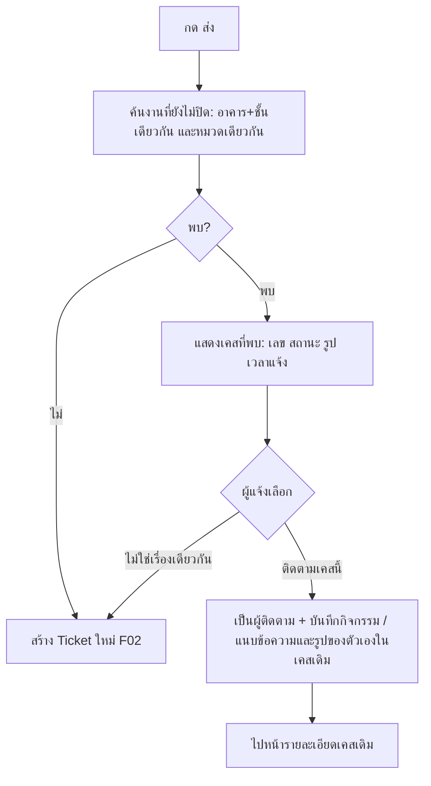

**Business rules**
- BR-F03-1: "ซ้ำ" = สถานะ `new` / `in_progress` / `resolved` + อาคารและชั้นเดียวกัน + หมวดเดียวกัน (ตามไฟล์แนบ)
- BR-F03-2: ผู้แจ้งเลือกเอง: ติดตามเคสนี้ หรือ แจ้งใหม่ (kickoff 2026-10-14)
- BR-F03-3: ผู้ติดตามได้รับแจ้งเตือนเหมือนผู้แจ้ง แต่ตรวจรับไม่ได้ (ตรวจรับได้เฉพาะผู้แจ้ง)

**Added by Claude**
- ข้อความ/รูปของผู้ติดตามถูกเพิ่มเป็นกิจกรรมในเคสเดิม
- BR-F03-3; พบหลายเคส → แสดงทั้งหมด ล่าสุดก่อน

## F04 — งานที่ทีมดำเนินการเอง

- **Actor:** หัวหน้าแม่บ้าน / หัวหน้ารปภ. · **Outcome:** Ticket `closed` (`team_handled`) ทันที ไม่มีแบบประเมิน

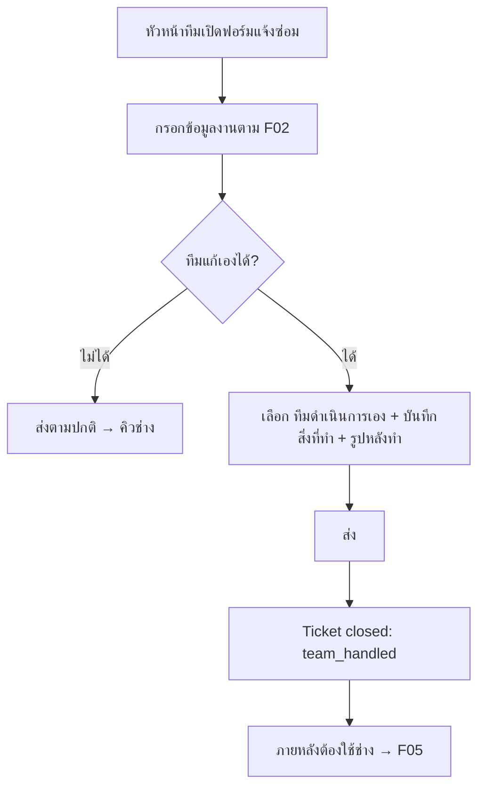

**Business rules**
- BR-F04-1: ตัวเลือก "ทีมดำเนินการเอง" เห็นเฉพาะ `housekeeper_lead`, `security_lead`
- BR-F04-2: ต้องกรอก "สิ่งที่ทีมทำ" และ**รูปหลังทำ ≥ 1** (approval 2026-10-14)
- BR-F04-3: ไม่มีแบบประเมิน ไม่เข้าคิวช่าง แต่ยังผ่านการตรวจงานซ้ำ (F03) ก่อน

## F05 — ส่งต่องานทีมให้ช่าง

- **Actor:** หัวหน้าทีมเจ้าของงาน หรือ Admin · **Outcome:** Ticket **เดิม** กลับเข้าคิวช่าง (`new`) เลขและประวัติเดิม

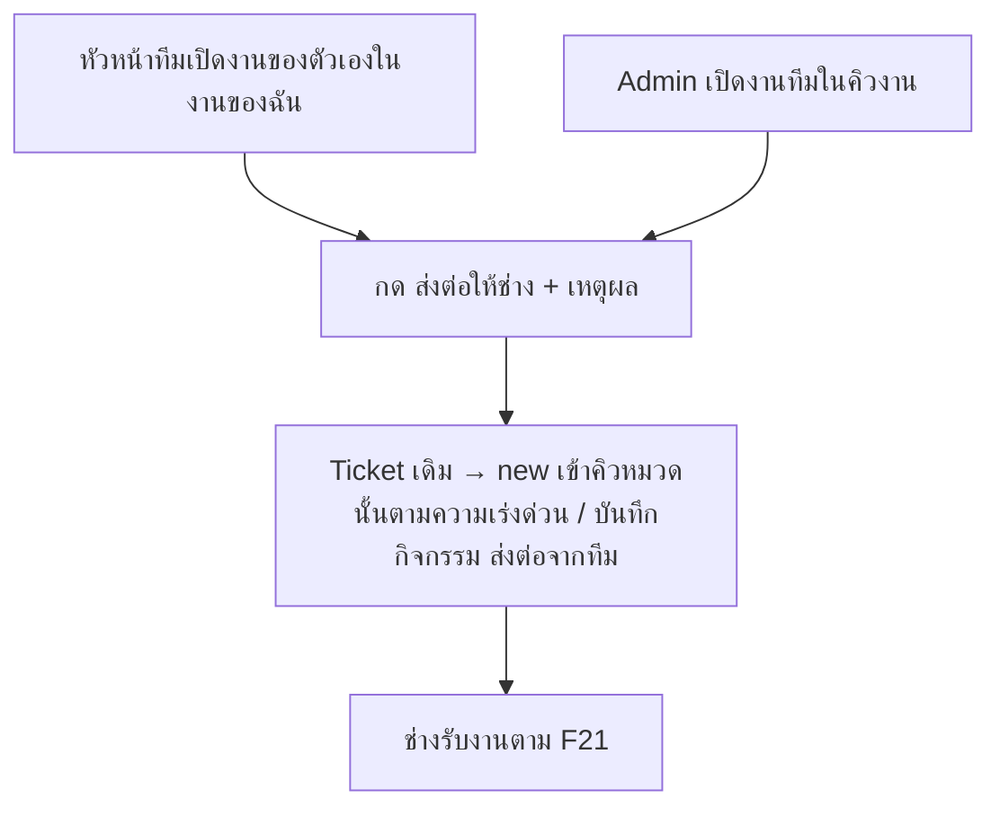

**Business rules**
- BR-F05-1: ใช้ได้เฉพาะ Ticket `closed` ที่ `closed_reason = team_handled`
- BR-F05-2: หัวหน้าทีมส่งต่อได้เฉพาะงานที่ตัวเองบันทึก; Admin ส่งได้ทุกงานทีม (แก้ gap ในไฟล์แนบ)
- BR-F05-3: ไม่สร้าง Ticket ใหม่ (ข้อกำหนด 13 ต.ค. 2569)

**Added by Claude**
- สถานะหลังส่งต่อ = `new` แทน `waiting_assignment` ของไฟล์แนบ เพราะไม่มีขั้นมอบหมายแล้ว (D-006)
- เหตุผลการส่งต่อ (บังคับ)

## F06 — ติดตามงานและประวัติ

- **Actor:** ทุก role · **Outcome:** เห็นสถานะ ไปต่อที่ตรวจรับ / ส่งต่อ

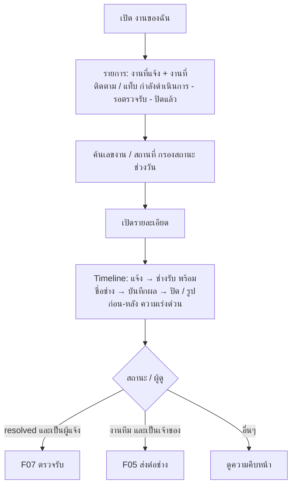

**Business rules**
- BR-F06-1: พนักงาน/หัวหน้าทีม/ช่าง เห็นงานที่ตัวเองแจ้งหรือติดตาม (แก้ Finding 02 ในไฟล์แนบ); Admin และผู้บริหารเห็นทุกงาน (approval 2026-10-14)
- BR-F06-2: งาน `resolved` ของผู้แจ้งอยู่บนสุด พร้อมป้าย "รอคุณตรวจรับ"
- BR-F06-3: Timeline แสดงทุกการเปลี่ยนสถานะ ใครทำ เมื่อไร; การเลื่อนคิวของ Admin ไม่แสดงให้ผู้แจ้ง (Added by Claude)

**Edge cases**
| Case | What happens |
|---|---|
| ยังไม่เคยแจ้ง | สถานะว่าง + มาสคอต + ปุ่ม "แจ้งซ่อม" |
| เปิดงานที่ไม่มีสิทธิ์ (ลิงก์ตรง) | หน้าไม่มีสิทธิ์ |
| โหลดไม่สำเร็จ | ข้อความผิดพลาด + ลองใหม่ |

## F07 — ตรวจรับ ให้คะแนน หรือส่งกลับให้แก้

- **Actor:** ผู้แจ้งเท่านั้น · **Trigger:** งาน `resolved` · **Outcome:** `closed` หรือกลับไปที่ช่างคนเดิม

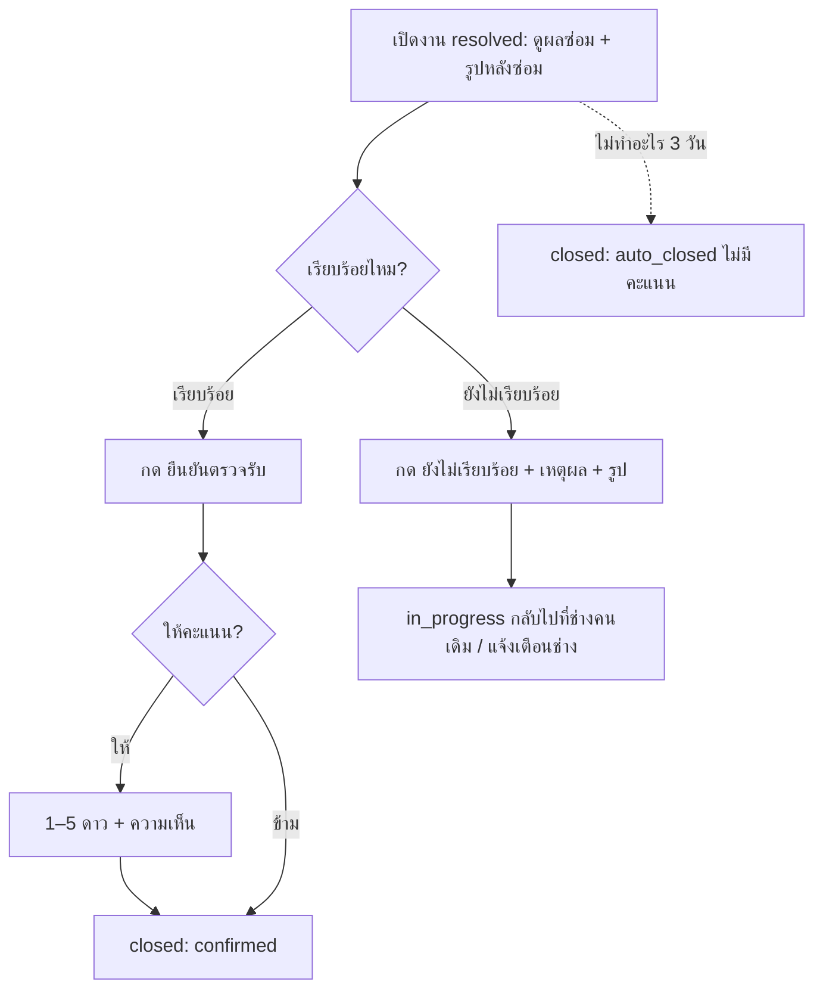

**Business rules**
- BR-F07-1: ตรวจรับ/ส่งกลับได้เฉพาะผู้แจ้ง (ตรวจที่ backend — แก้ Finding 02)
- BR-F07-2: คะแนน 1–5 ไม่บังคับ
- BR-F07-3: ส่งกลับ → กลับไปที่ช่างคนเดิม; เหตุผลบังคับ (kickoff). ถ้าช่างคนเดิมว่าง → `in_progress` ทันที; ถ้ากำลังถืองานอื่น → `new` แบบ**จองไว้ให้ช่างคนนั้น** ไม่แสดงในคิวของช่างอื่น และขึ้นเป็น "งานถัดไปของคุณ" ของช่างคนเดิม (CR-001)
- BR-F07-4: ไม่ตรวจรับภายใน 3 วันหลัง `resolved` → ปิดอัตโนมัติ (`auto_closed`) (kickoff) — นับ **วันปฏิทิน** 3 × 24 ชม. นับจากเวลาที่เป็น `resolved` (approval 2026-10-14)
- BR-F07-5: งานทีมทำเอง (F04) ไม่มีขั้นนี้
- BR-F07-6: Admin ปิดได้โดยไม่รอขั้นนี้ (F08-B)

**Added by Claude**
- แจ้งเตือนผู้แจ้งก่อนปิดอัตโนมัติ 1 วัน
- ส่งกลับได้ไม่จำกัดครั้ง Admin เห็นจำนวนครั้งในงาน

## F08-B — Admin ปิด Ticket ได้ทุกงาน

- **Actor:** Admin · **Outcome:** `closed` (`admin_closed`) จากสถานะใดก็ได้ที่ยังไม่ปิด

1. เลือก Ticket → กด "ปิดงาน" → ใส่เหตุผล → ยืนยันในกล่องยืนยัน
2. แจ้งเตือนผู้แจ้ง ผู้ติดตาม และช่างที่ถืองาน

- BR-F08B-1: ไม่จำกัดผู้แจ้ง/ผู้รับผิดชอบ, ไม่ต้องผ่าน `resolved` (ข้อกำหนด 13 ต.ค. 2569)
- **Added by Claude:** เหตุผลบังคับ, ยืนยันก่อนปิด, แจ้งเตือนผู้เกี่ยวข้อง

## F13-B — สแกน QR ที่อุปกรณ์ → เติมฟอร์ม

- **Actor:** ทุก role · **Outcome:** ฟอร์ม F02 ที่กรอกอุปกรณ์ หมวด อาคาร ชั้น ไว้ให้แล้ว

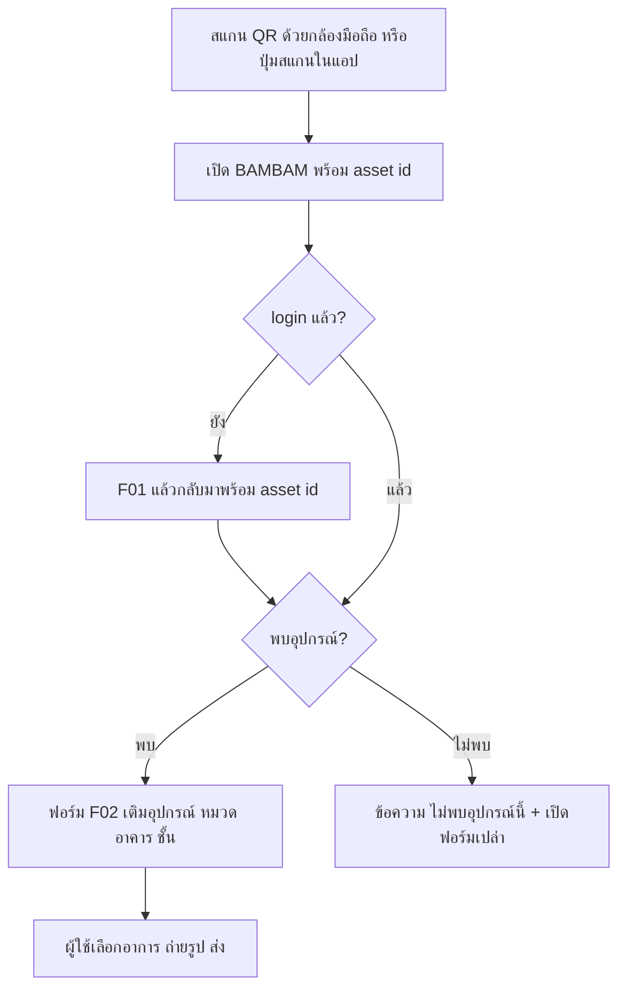

- BR-F13B-1: ข้อมูลอุปกรณ์ phase 1 มาจากไฟล์ seed ✏️ ขอไฟล์รายการอุปกรณ์ (POC เดิมใช้ `bam-assets.csv`)
- BR-F13B-2: ค่าที่เติมให้ ผู้ใช้แก้ได้
- **Added by Claude:** asset id ต้องอยู่รอดหลัง login (ตอบคำถามในไฟล์แนบ), กรณีไม่พบอุปกรณ์
- Open: ป้าย QR (F13-A) phase 1 ทำอย่างไร — ตัดสินใน `/stage-plan` (ไม่กระทบหน้าจอผู้ใช้)

## F19-B — แจ้งเตือนเฉพาะตัว (กระดิ่ง)

| เหตุการณ์ | ใครได้รับ |
|---|---|
| งานใหม่ในหมวด | ช่างในหมวดนั้น |
| ช่างรับงาน | ผู้แจ้ง + ผู้ติดตาม |
| ช่างคืนงาน | ผู้แจ้ง + ผู้ติดตาม |
| ซ่อมเสร็จ รอตรวจรับ | ผู้แจ้ง (+ ผู้ติดตาม เพื่อทราบ) |
| ผู้แจ้งส่งกลับให้แก้ | ช่างคนเดิม |
| เตือนก่อนปิดอัตโนมัติ / ปิดอัตโนมัติ | ผู้แจ้ง |
| Admin ปิดงาน | ผู้แจ้ง + ผู้ติดตาม + ช่างที่ถืองาน |

- BR-F19B-1: แจ้งเตือนในแอปเท่านั้น (ไม่มี LINE/อีเมลใน phase 1); แต่ละคนเห็นเฉพาะของตัวเอง (แก้ Finding 08) (kickoff)
- BR-F19B-2: กดรายการ → ไปหน้ารายละเอียดงาน; มีตัวเลขยังไม่อ่านบนกระดิ่ง
- **Added by Claude:** ตารางผู้รับทั้งหมด

## F21 — คิวงานช่าง: รับงาน → บันทึกผล / คืนงาน (ใหม่, D-006)

- **Actor:** ช่างเทคนิค · **Outcome:** งาน `resolved` หรือคืนเข้าคิว

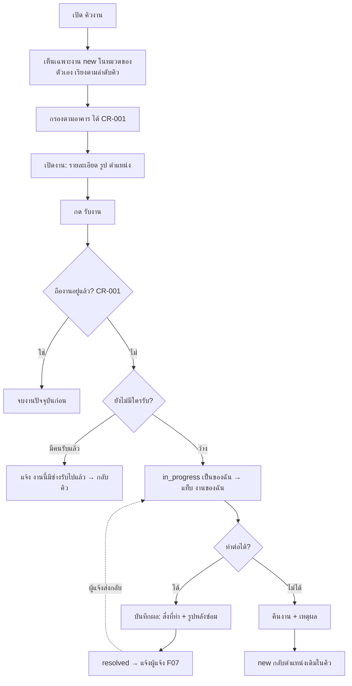

**Business rules**
- BR-F21-1: ช่างเห็นเฉพาะงาน `new` ในหมวดที่ตัวเองรับผิดชอบ (ไฟล์ seed) + งานที่ตัวเองถือ + งานที่จองไว้ให้ตัวเอง (kickoff, CR-001)
- BR-F21-2: รับงานได้คนเดียว — กดพร้อมกัน คนที่สองได้ข้อความ "งานนี้มีช่างรับไปแล้ว"
- BR-F21-3: ช่างถืองาน `in_progress` ได้**ทีละ 1 งาน** ต้องจบงานก่อน (บันทึกผลเป็น `resolved` หรือคืนงาน) จึงรับงานใหม่ได้; ถ้ามีงานที่จองไว้ให้ (BR-F07-3) ต้องเริ่มงานนั้นก่อนรับงานอื่น; backend ปฏิเสธการรับงานซ้อน (CR-001)
- BR-F21-4: บันทึกผล: "สิ่งที่ทำ" และ**รูปหลังซ่อม ≥ 1** บังคับ (approval 2026-10-14); ค่าใช้จ่ายมาทีหลัง (F10)
- BR-F21-5: คืนงานต้องใส่เหตุผล; งานกลับตำแหน่งเดิมในคิว (kickoff)
- BR-F21-6: ช่างรับงานข้ามลำดับได้ รายการแสดงตามลำดับคิวเสมอ (CR-001)
- BR-F21-7: มีตัวกรองตามอาคาร (เลือกได้ "ทุกอาคาร"); ตัวกรองไม่เปลี่ยนลำดับ (CR-001)
- BR-F21-8: Admin ปิดงานที่ช่างถืออยู่ (F08-B) → ช่างว่างทันที (CR-001)

**Edge cases**
| Case | What happens |
|---|---|
| คิวว่าง | สถานะว่าง + มาสคอต "ยังไม่มีงานในหมวดของคุณ" |
| ไม่มีหมวดที่รับผิดชอบ | "ยังไม่ได้กำหนดหมวดงาน ติดต่อ Admin" |
| Admin ปิดงานที่กำลังทำ | งานหายจากงานของฉัน + แจ้งเตือน |
| กดรับงานขณะถืองานอยู่ | ปุ่มรับงานปิด + "จบงานปัจจุบันก่อน (บันทึกผล หรือ คืนงาน)"; ถ้ากดพร้อมกันจากอีกเครื่อง backend ปฏิเสธ (CR-001) |
| มีงานที่ผู้แจ้งส่งกลับรออยู่ | แสดงบนสุดเป็น "งานถัดไปของคุณ — ส่งกลับให้แก้" + ปุ่มเริ่มงาน (CR-001) |
| ตัวกรองอาคารแล้วไม่มีงาน | "ไม่มีงานในอาคารนี้" + ปุ่มดูทุกอาคาร (CR-001) |

## F22 — Admin จัดลำดับคิวและปรับความเร่งด่วน (ใหม่, D-006, D-007)

- **Actor:** Admin (desktop เป็นหลัก) · **Outcome:** ลำดับคิวที่ช่างเห็นเปลี่ยนทันที

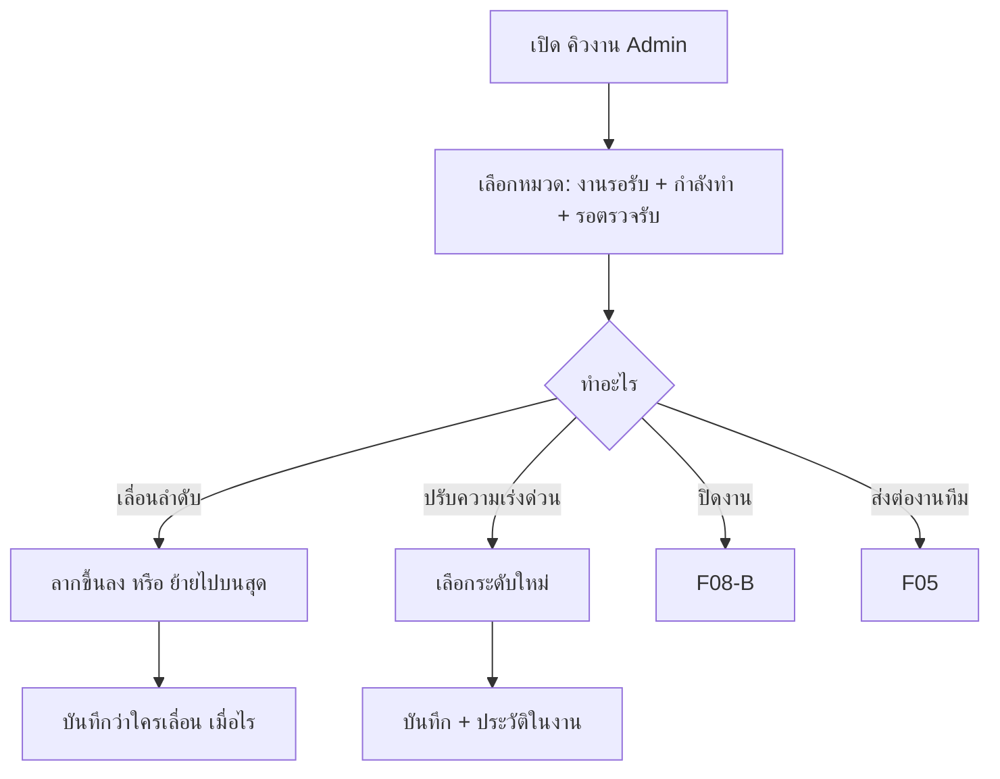

**Business rules**
- BR-F22-1: ลำดับอัตโนมัติ: ฉุกเฉิน → สูง → ปกติ → ต่ำ แล้วตามเวลาแจ้ง (เก่าก่อน)
- BR-F22-2: งานที่ Admin เลื่อนแล้วคงตำแหน่งนั้น; งานใหม่แทรกต่อท้ายงานที่เร่งด่วนเท่ากัน (kickoff)
- BR-F22-3: ทุกการเลื่อน/ปรับความเร่งด่วนบันทึก audit (ใคร เมื่อไร จาก → ไป) (D-006)
- BR-F22-4: ปรับความเร่งด่วนของงานที่ถูกเลื่อนไว้แล้ว → งานนั้นกลับไปเรียงอัตโนมัติ (Added by Claude)
- BR-F22-5: เลื่อนได้เฉพาะงาน `new` (งานที่มีคนรับแล้วไม่อยู่ในคิว)
- BR-F22-6: ผู้บริหารเห็นหน้าคิวงานแบบเดียวกับ Admin แต่**อ่านอย่างเดียว**: เลื่อนลำดับ ปรับความเร่งด่วน ปิดงาน ส่งต่อ ไม่ได้ (approval 2026-10-14)

## F23 — ภาพรวมอาคาร 3D (ใหม่, D-010 — mockup ก่อน)

- **Actor:** Admin, ผู้บริหาร (ดูอย่างเดียว) · **Outcome:** เห็นว่าชั้นไหน/จุดไหนมีงานค้าง

1. เปิดหน้าภาพรวม → โมเดล 3D คร่าวของสำนักงานใหญ่ (อ้างอิง `attachments/cpac-building.png`: อาคารหลักประมาณ 6–7 ชั้น + อาคารเตี้ยด้านหลัง)
2. หมุดบนแต่ละชั้นแสดงจำนวนงานที่ยังไม่ปิด สีตามความเร่งด่วนสูงสุดในชั้นนั้น
3. กดชั้น → รายการงานในชั้นนั้น; กดงาน → รายละเอียด (S07)

- Open (ไม่บล็อก): จำนวนชั้นจริง, อาคารด้านหลัง, ชื่อชั้น — ผู้ใช้จะแก้รายละเอียดภายหลัง; build อยู่ stage ไหนตัดสินใน `/stage-plan`

---

## Later flows (from the attachment, not detailed yet)

F08 ศูนย์จัดการงานส่วนอื่น · F09 สถานะและ SLA · F10 ค่าใช้จ่าย · F11 Insights · F12 คลังอุปกรณ์ · F13-A สร้างป้าย QR · F14 ผังอาคาร 2D/3D · F15 จัดการผู้ใช้ / role / หมวดของช่าง · F16 แชท · F17 คำขอจัดห้อง (อาจย้ายไป room_booking) · F18 บริการภายนอก (อาจถูกแทนด้วย car_booking / room_booking) · F19-A ภาษา/ธีม · F20 ส่วนที่ยังไม่เชื่อม

## Open questions (summary)

ข้อมูลจริงสำหรับไฟล์ seed (ต้องมีก่อน mockup ใช้ข้อมูลจริงได้; ระหว่างนี้ใช้ข้อมูลตัวอย่างที่ระบุว่าเป็นตัวอย่าง): หมวดงาน + อาการ, ช่าง ↔ หมวด, อาคาร / ชั้น, รายการอุปกรณ์สำหรับ QR
