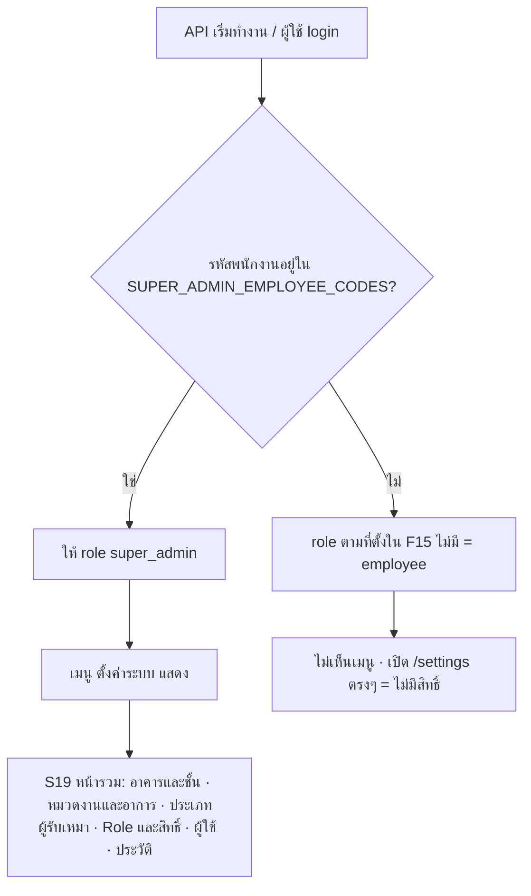
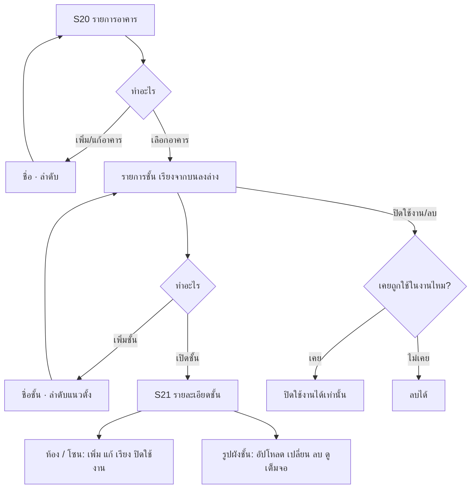
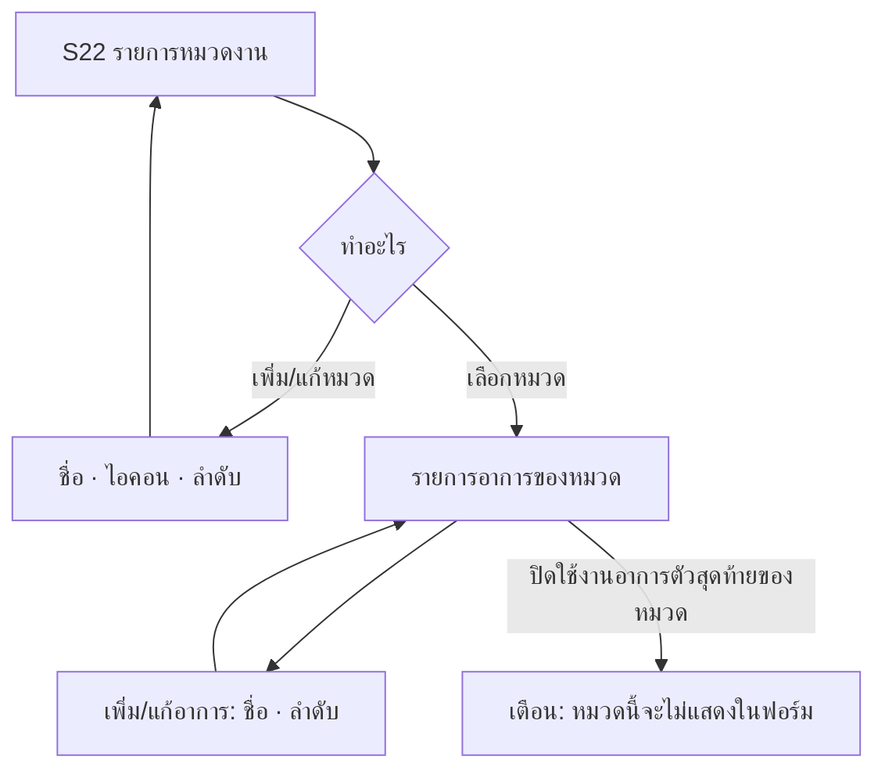
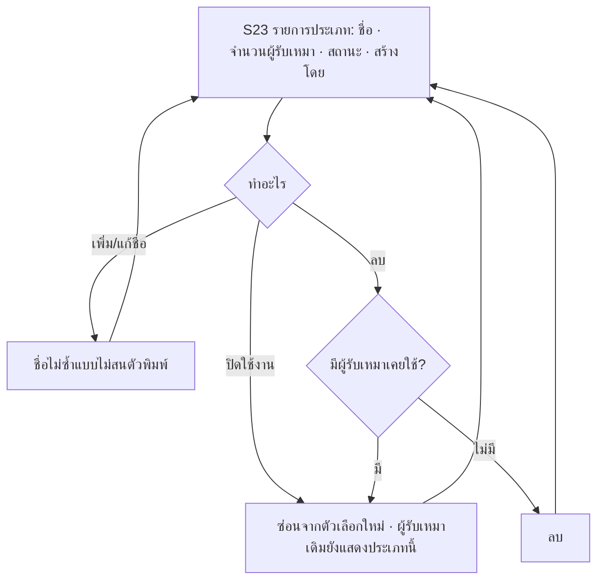
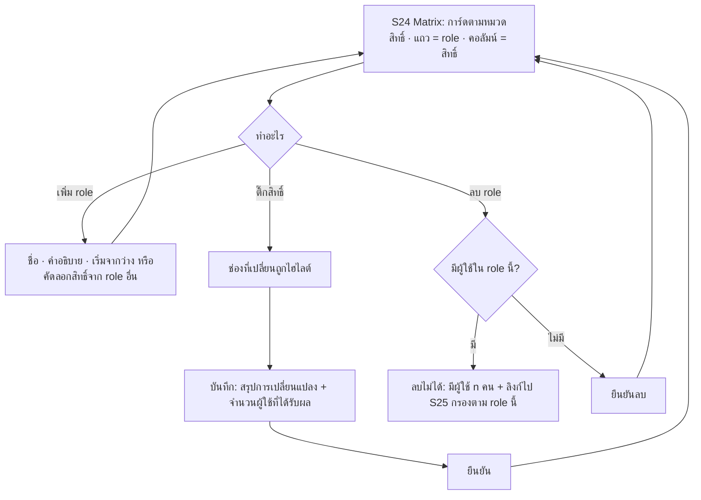
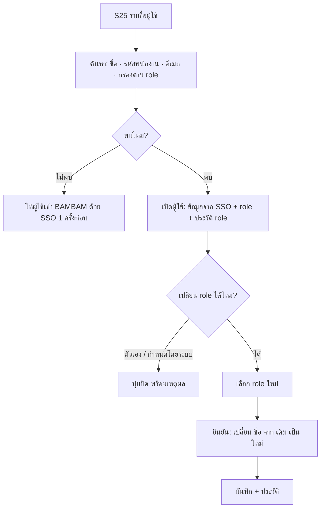
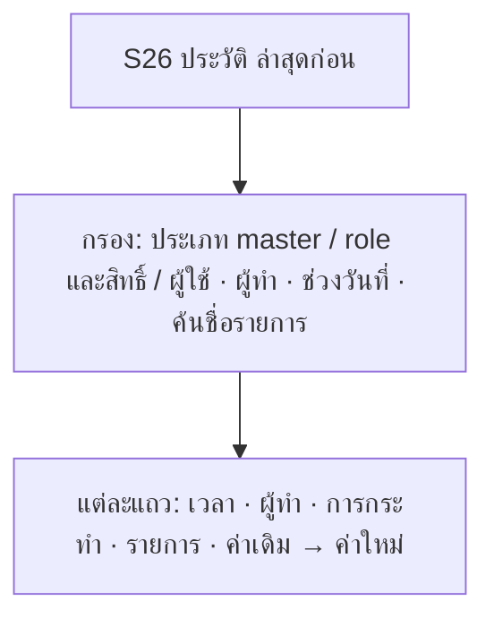

# ตั้งค่าระบบ (Superadmin) — User flows

Status: APPROVED (2026-10-16) — user: "ทำเลย" with Claude's proposals for the open questions; matrix layout follows `attachments/matrix-permission-reference.png`

<!-- Written by Claude in discovery (2026-10-15) from 00-brief.md + 3 interview rounds.
     Flow and screen IDs are unique across the project: F15 keeps the source ID (repair/attachments/BAMBAM-User-Flow02.html
     F15 "จัดการผู้ใช้"); new flows continue after repair (F25+), screens after repair S18 (S19+).
     Source F14-B (Admin แก้ผัง โซน ห้อง หมุด) is replaced by F26. "Added by Claude" lists every addition.
     Changes after approval go through a CR. -->

## Flow index

| ID | Flow | Actor | Priority | Screens |
|---|---|---|---|---|
| F25 | เข้าเมนูตั้งค่าระบบ และ Superadmin คนแรก | Superadmin, ผู้ดูแล server | must | S19 ตั้งค่าระบบ |
| F26 | อาคาร ชั้น ห้อง และรูปผังชั้น | Superadmin | must | S20 อาคารและชั้น, S21 รายละเอียดชั้น |
| F27 | หมวดงานและอาการ | Superadmin | must | S22 หมวดงานและอาการ |
| F28 | ประเภทผู้รับเหมา | Superadmin | must | S23 ประเภทผู้รับเหมา |
| F29 | Role และ Matrix สิทธิ์ | Superadmin | must | S24 Role และสิทธิ์ |
| F15 | จัดการผู้ใช้ (เปลี่ยน role) | Superadmin | must | S25 ผู้ใช้ |
| F30 | ประวัติการเปลี่ยนแปลง | Superadmin | must | S26 ประวัติการเปลี่ยนแปลง, S25 |

## Rules for every flow

- BR-ALL-1: ทุกหน้าและทุก API ของโมดูลนี้ใช้ได้เฉพาะ `super_admin`; role อื่นไม่เห็นเมนู และเปิด URL ตรงได้หน้า "ไม่มีสิทธิ์" (API ตอบ 403)
- BR-ALL-2: master ทุกชนิด **ไม่ลบเมื่อเคยถูกใช้** — ปิดใช้งานแทน: ซ่อนจากตัวเลือกใหม่ งานเก่ายังแสดงชื่อเดิม เปิดใช้งานกลับได้; ลบจริงได้เฉพาะรายการที่ไม่เคยถูกอ้างอิง
- BR-ALL-3: แก้ชื่อ master มีผลทุกที่ รวมงานเก่า (งานอ้างอิงรายการ ไม่ได้เก็บชื่อแยก)
- BR-ALL-4: ทุกการเพิ่ม/แก้/ปิด/ลบ ในโมดูลนี้บันทึกประวัติ (F30)
- BR-ALL-5: ลำดับที่ตั้งในหน้านี้คือลำดับที่ผู้ใช้เห็นในตัวเลือกของทุกระบบ

**Added by Claude**
- ถ้า Superadmin 2 คนแก้รายการเดียวกันพร้อมกัน คนที่บันทึกทีหลังได้ข้อความ "ข้อมูลนี้ถูกแก้โดย {ชื่อ} เมื่อ {เวลา} โหลดข้อมูลล่าสุดก่อนบันทึก" (ไม่ทับกันเงียบๆ)
- Layout: desktop เป็นหลัก (D-008); บนมือถือใช้ได้ครบแต่จัดเป็นรายการ/ฟอร์มทีละหน้า (รายละเอียดใน P3)

---

## F25 — เข้าเมนูตั้งค่าระบบ และ Superadmin คนแรก

- **Actor:** Superadmin; ผู้ดูแล server (ตั้ง env)
- **Trigger:** Superadmin กดเมนู "ตั้งค่าระบบ"
- **Preconditions:** login ผ่าน SSO แล้ว และมี role `super_admin`
- **Outcome:** เห็นหน้ารวมตั้งค่า เลือกไปแต่ละส่วนได้

**Steps**
1. ผู้ดูแล server ใส่รหัสพนักงานของ Superadmin คนแรกใน env ของแต่ละ environment
2. คนนั้น login ผ่าน SSO → ได้ role `super_admin` → เห็นเมนู "ตั้งค่าระบบ" (sidebar desktop, เมนูในโปรไฟล์บนมือถือ)
3. S19 แสดงการ์ดแต่ละส่วนพร้อมตัวเลขสรุป (จำนวนอาคาร/ชั้น, หมวด, ประเภทผู้รับเหมา, role, ผู้ใช้)

**Edge cases**
| Case | What the user sees / what happens |
|---|---|
| ไม่มีรหัสใน env และยังไม่มี super_admin | ไม่มีใครเข้าหน้านี้ได้; API log คำเตือนตอนเริ่ม |
| role อื่นเปิด `/settings/...` ตรงๆ | หน้า "ไม่มีสิทธิ์" (ForbiddenState) |
| Superadmin ถูกลด role ระหว่างเปิดหน้าอยู่ | คำขอถัดไปได้ 403 → หน้า "ไม่มีสิทธิ์" และเมนูหายเมื่อโหลดใหม่ |
| Network / server error | ErrorState พร้อมปุ่มลองใหม่ |

**Business rules**
- BR-F25-1: `super_admin` เป็น role ของระบบ: มีทุกสิทธิ์ของทุกระบบเสมอ แก้สิทธิ์ไม่ได้ ลบไม่ได้
- BR-F25-2: Superadmin คนแรกกำหนดด้วยรหัสพนักงานใน env (`SUPER_ADMIN_EMPLOYEE_CODES`, หลายคนคั่นด้วย comma)

**Added by Claude**
- รหัสใน env เป็น super_admin **เสมอ** (ระบบตั้งให้ตอนเริ่มและทุกครั้งที่ login) และเปลี่ยน role จากหน้าจอไม่ได้ (S25 แสดง "กำหนดโดยระบบ") — เป็นทางกู้คืนเมื่อไม่มี Superadmin เหลือในระบบ
- dev/UAT: ตัวสลับบทบาทมีผู้ใช้ตัวอย่างของ `super_admin` ด้วย (D-005); การตั้งค่าที่ทำผ่านผู้ใช้ตัวอย่างมีผลกับข้อมูลของ environment นั้นจริง

---

## F26 — อาคาร ชั้น ห้อง และรูปผังชั้น

- **Actor:** Superadmin
- **Trigger:** ต้องใส่ข้อมูลอาคารครั้งแรก หรือพื้นที่จริงเปลี่ยน (เพิ่มชั้น กั้นห้องใหม่ ปรับผัง)
- **Preconditions:** F25
- **Outcome:** อาคาร ชั้น ห้อง และรูปผังชั้นตรงของจริง ใช้ในฟอร์มแจ้งซ่อม (อาคาร/ชั้น) และภาพรวมอาคาร repair S12

**Steps**
1. S20: รายการอาคาร (ชื่อ จำนวนชั้น สถานะ) → เพิ่มอาคาร: ชื่อ
2. เลือกอาคาร → รายการชั้นเรียงจากชั้นบนสุดลงล่าง (เหมือนตึกจริง) → เพิ่มชั้น: ชื่อชั้น + ตำแหน่ง
3. เปิดชั้น → S21: แท็บ/ส่วน "ห้อง / โซน" (ชื่อ, ลำดับ) และ "ผังชั้น" (รูป 1 รูป)
4. อัปโหลดรูปผังชั้น → แสดงตัวอย่าง → บันทึก; กดรูปเพื่อดูเต็มจอ (ซูมได้)

**Edge cases**
| Case | What the user sees / what happens |
|---|---|
| ยังไม่มีอาคาร (empty) | EmptyState "ยังไม่มีข้อมูลอาคาร" + ปุ่มเพิ่มอาคาร |
| อาคารยังไม่มีชั้น / ชั้นยังไม่มีห้อง / ยังไม่มีผัง | EmptyState ในส่วนนั้น + ปุ่มเพิ่ม |
| ชื่อซ้ำ (อาคารซ้ำ, ชั้นซ้ำในอาคาร, ห้องซ้ำในชั้น) | ข้อความใต้ช่อง "ชื่อนี้มีอยู่แล้ว" |
| ปิดใช้งานชั้นที่มีงานซ่อมยังไม่ปิด | เตือน "มีงานที่ยังไม่ปิด {n} งานในชั้นนี้" แล้วให้ยืนยัน; งานเหล่านั้นทำต่อได้ตามปกติ |
| ปิดใช้งานอาคาร | ชั้นและห้องทั้งหมดในอาคารถูกซ่อนจากตัวเลือกใหม่ด้วย (ไม่เปลี่ยนสถานะของแต่ละชั้น) |
| รูปผังชั้นไม่ใช่ JPG/PNG หรือใหญ่เกิน 10 MB | ข้อความ "รองรับ JPG, PNG ไม่เกิน 10 MB" ไม่อัปโหลด |
| อัปโหลดล้มเหลว | ข้อความผิดพลาด + ลองใหม่ รูปเดิม (ถ้ามี) ยังอยู่ |
| ผู้แจ้งกำลังกรอกฟอร์มอยู่ตอนชั้นถูกปิดใช้งาน | กดส่งแล้วได้ข้อความ "ชั้นนี้ถูกปิดใช้งานแล้ว กรุณาเลือกใหม่" (repair) |

**Business rules**
- BR-F26-1: อาคาร: ชื่อ (บังคับ, ไม่ซ้ำ), ลำดับ; ชั้น: ชื่อชั้น (บังคับ เช่น "1", "G", "ดาดฟ้า", ไม่ซ้ำในอาคาร), ลำดับแนวตั้ง (ล่างสุดก่อน, ไม่ซ้ำในอาคาร — repair S12 สร้างโมเดลตึกจากลำดับนี้)
- BR-F26-2: ห้อง / โซน อยู่ในชั้น: ชื่อ (บังคับ, ไม่ซ้ำในชั้น), ลำดับ; **ยังไม่ใช้ในฟอร์มแจ้งซ่อม** (ผู้แจ้งยังพิมพ์ "จุดที่เกิด" เอง) แสดงใน S21 และเตรียมไว้ให้ระบบจองห้องประชุม
- BR-F26-3: รูปผังชั้น 1 รูปต่อชั้น JPG/PNG ไม่เกิน 10 MB (เท่ารูปงานซ่อม D-022); อัปโหลดใหม่ = แทนที่รูปเดิม; ลบได้; ดูอย่างเดียว ไม่มีการปักหมุดบนรูป
- BR-F26-4: รูปผังชั้นเปิดดูได้จาก S21 และจากชั้นที่เลือกในภาพรวมอาคาร repair S12 (CR ของ repair)

**Added by Claude**
- "เพิ่มหลายชั้น": ใส่จำนวนชั้น N → สร้างชั้น 1…N (ชื่อ = เลขชั้น) ทีเดียว สำหรับตั้งค่าตึกครั้งแรก
- เรียงชั้นและห้องด้วยลากวาง (มีปุ่มเลื่อนขึ้น/ลงสำหรับคีย์บอร์ดและมือถือ)

**Decided at approval (2026-10-16)**
- BR-F26-5: ภาพรวมอาคาร S12 ยังแสดงชั้นที่ปิดใช้งานแล้วจนกว่างานที่ยังไม่ปิดในชั้นนั้นจะปิดครบ (CR ของ repair S12)

**Open questions**
- อาคาร/ชั้น/ห้องจะเป็นข้อมูลกลาง (ใช้ร่วมกับจองห้องประชุม) — ย้ายจาก schema `repair` ไปที่ไหน ตัดสินใน P4

---

## F27 — หมวดงานและอาการ

- **Actor:** Superadmin
- **Trigger:** ต้องการเพิ่ม/ปรับตัวเลือกหมวดงานหรืออาการในฟอร์มแจ้งซ่อม
- **Preconditions:** F25
- **Outcome:** ฟอร์มแจ้งซ่อม (repair S03) แสดงหมวดและอาการตามที่ตั้งไว้

**Steps**
1. S22: รายการหมวด (ไอคอน ชื่อ จำนวนอาการ สถานะ) เรียงตามลำดับในฟอร์ม
2. เพิ่ม/แก้หมวด: ชื่อ, ไอคอน (เลือกจากชุดไอคอนที่มีให้), ลำดับ
3. เลือกหมวด → รายการอาการของหมวดนั้น → เพิ่ม/แก้/เรียง/ปิดใช้งาน

**Edge cases**
| Case | What the user sees / what happens |
|---|---|
| ยังไม่มีหมวด | EmptyState + ปุ่มเพิ่มหมวด; ฟอร์มแจ้งซ่อมแสดง "ยังไม่มีหมวดงาน ติดต่อผู้ดูแลระบบ" |
| ชื่อซ้ำ (หมวดซ้ำ, อาการซ้ำในหมวด) | "ชื่อนี้มีอยู่แล้ว" |
| ปิดใช้งานหมวด | หมวดและอาการทั้งหมดในหมวดหายจากฟอร์ม; งานเก่าแสดงชื่อเดิม |
| ปิดใช้งาน/ลบอาการตัวสุดท้ายที่เปิดอยู่ของหมวด | เตือนว่าหมวดจะไม่แสดงในฟอร์ม (ฟอร์มบังคับเลือกอาการ ≥ 1, repair BR-F02-1) แล้วให้ยืนยัน |

**Business rules**
- BR-F27-1: หมวด: ชื่อ (บังคับ, ไม่ซ้ำ), ไอคอน (ค่าเริ่มต้น ประแจ), ลำดับ; อาการ: อยู่ใต้หมวดเดียว, ชื่อ (บังคับ, ไม่ซ้ำในหมวด), ลำดับ
- BR-F27-2: หมวดที่ไม่มีอาการที่เปิดใช้งานเลย จะไม่แสดงในฟอร์มแจ้งซ่อม

**Added by Claude**
- ย้ายอาการไปหมวดอื่นไม่ได้ (เพิ่มใหม่ในหมวดที่ถูกแล้วปิดตัวเดิม) เพื่อไม่ให้งานเก่าเปลี่ยนหมวด

---

## F28 — ประเภทผู้รับเหมา

- **Actor:** Superadmin (ช่างยังเพิ่มประเภทใหม่ได้ตอนประเมินงาน ตาม D-041)
- **Trigger:** มีประเภทซ้ำ สะกดผิด หรืออยากเตรียมประเภทไว้ล่วงหน้า
- **Preconditions:** F25
- **Outcome:** ตัวเลือกประเภทผู้รับเหมาในหน้าช่างภายนอก/ประเมินงาน (repair S17, S18) สะอาด

**Edge cases**
| Case | What the user sees / what happens |
|---|---|
| ยังไม่มีประเภท | EmptyState + ปุ่มเพิ่ม |
| ชื่อซ้ำ (ไม่สนตัวพิมพ์) | "ชื่อนี้มีอยู่แล้ว" |
| ช่างพิมพ์ชื่อตรงกับประเภทที่ถูกปิดใช้งาน | ใช้ประเภทเดิมและเปิดใช้งานกลับให้อัตโนมัติ (ไม่สร้างซ้ำ) |

**Business rules**
- BR-F28-1: ประเภท: ชื่อ (บังคับ, ไม่ซ้ำแบบไม่สนตัวพิมพ์ — D-041), ปิดใช้งานได้; ช่างยังสร้างประเภทใหม่ในหน้าได้เหมือนเดิม

**Added by Claude**
- คอลัมน์ "สร้างโดย" (ช่าง / Superadmin) เพื่อให้เห็นประเภทที่ช่างสร้างขึ้นเอง
- กรณีช่างพิมพ์ชื่อประเภทที่ถูกปิดใช้งาน (edge case ด้านบน) — เสนอให้เปิดกลับอัตโนมัติ ถ้าไม่ต้องการให้บอก

**Later**
- รวมประเภทที่ซ้ำกัน (merge)

---

## F29 — Role และ Matrix สิทธิ์

- **Actor:** Superadmin
- **Trigger:** ต้องการ role ใหม่ (เช่น "หัวหน้าช่าง") หรือปรับว่า role ไหนทำอะไรได้
- **Preconditions:** F25
- **Outcome:** ผู้ใช้ทุกคนใน role นั้นได้สิทธิ์ใหม่ทันทีในคำขอถัดไป

**Steps**
1. S24 แสดง matrix ตามตัวอย่างของ user (`attachments/matrix-permission-reference.png`): หัวข้อตามระบบ ("ระบบแจ้งซ่อม"; ระบบอื่นมาเมื่อระบบนั้นเริ่ม) → การ์ดตามหมวดสิทธิ์ → ในการ์ด แถวคือ role (พร้อมจำนวนผู้ใช้) คอลัมน์คือสิทธิ์ในหมวดนั้น เป็น checkbox; แถว `super_admin` ติ๊กครบและล็อก; สิทธิ์พื้นฐานไม่อยู่ในตาราง แสดงเป็นข้อความว่าทุก role มีเสมอ
2. ติ๊ก/เอาติ๊กออกได้หลายช่อง → ปุ่ม "บันทึก" แสดงจำนวนช่องที่เปลี่ยน
3. กดบันทึก → dialog สรุป "role {ชื่อ}: เพิ่ม {สิทธิ์}, ถอด {สิทธิ์} · กระทบผู้ใช้ {n} คน" → ยืนยัน
4. เพิ่ม role: ชื่อ, คำอธิบาย, เลือก "เริ่มจากว่าง (สิทธิ์พื้นฐานเท่านั้น)" หรือ "คัดลอกจาก {role}"
5. แก้ชื่อ/คำอธิบาย role ได้ (รวม `employee`)

**Edge cases**
| Case | What the user sees / what happens |
|---|---|
| ออกจากหน้าโดยยังไม่บันทึก | ถาม "มีการเปลี่ยนแปลงที่ยังไม่บันทึก ออกเลยไหม" |
| ลบ role ที่ยังมีผู้ใช้ | ลบไม่ได้: "มีผู้ใช้ {n} คนใน role นี้ ย้ายไป role อื่นก่อน" + ลิงก์ไป S25 กรองตาม role |
| ลบ `employee` หรือ `super_admin` | ไม่มีปุ่มลบ |
| ชื่อ role ซ้ำ | "ชื่อนี้มีอยู่แล้ว" |
| Superadmin อีกคนบันทึก matrix ก่อน | "Matrix ถูกแก้โดย {ชื่อ} เมื่อ {เวลา} โหลดล่าสุดก่อนบันทึก" (การเปลี่ยนแปลงที่ยังไม่บันทึกถูกแสดงให้ทำซ้ำ) |
| ผู้ใช้ที่ถูกถอดสิทธิ์กำลังเปิดหน้านั้นอยู่ | คำขอถัดไปได้ 403 → หน้า "ไม่มีสิทธิ์"; เมนูเปลี่ยนเมื่อโหลดหน้าใหม่ |

**Business rules**
- BR-F29-1: รายการสิทธิ์ (permission) เป็นระดับการกระทำ กำหนดในโค้ด เพิ่มได้ตอนพัฒนาเท่านั้น; ค่าตั้งต้นและรายการเริ่มต้นอยู่ใน `01-users.md` → Permission catalog
- BR-F29-2: ค่าตั้งต้นของ matrix ต้องให้ผลเหมือนพฤติกรรมวันนี้ทุก role (6 role เดิม + `super_admin`)
- BR-F29-3: 1 คนมี 1 role (D-004 คงเดิมในข้อนี้); สิทธิ์พื้นฐานทุก role มีเสมอ (เท่ากับ "ทุก role ทำสิ่งที่ `employee` ทำได้")
- BR-F29-4: role: ชื่อ (บังคับ, ไม่ซ้ำ, ≤ 50 ตัวอักษร), คำอธิบาย (ไม่บังคับ); ชื่อ role แสดงทุกที่ที่แสดง role (โปรไฟล์, ตัวสลับบทบาท, S25)
- BR-F29-5: `employee` = role ของคนที่ login ครั้งแรก: ลบไม่ได้, แก้ชื่อและสิทธิ์ (ที่ไม่ใช่พื้นฐาน) ได้; `super_admin`: ลบไม่ได้ แก้สิทธิ์ไม่ได้
- BR-F29-6: ลบ role ได้เฉพาะเมื่อไม่มีผู้ใช้ใน role นั้น
- BR-F29-7: การเปลี่ยนสิทธิ์มีผลทันทีในคำขอถัดไปของผู้ใช้ ไม่ต้อง logout

**Added by Claude**
- เพิ่ม role แบบ "คัดลอกสิทธิ์จาก role อื่น"
- บันทึกทีเดียวพร้อม dialog สรุปและจำนวนผู้ใช้ที่ได้รับผล (แทนบันทึกทุกครั้งที่ติ๊ก) กันติ๊กพลาด
- บนมือถือ matrix แสดงทีละ role (เลือก role → การ์ดตามหมวด รายการสิทธิ์เป็นสวิตช์)
- dev/UAT: ตัวสลับบทบาทแสดงทุก role ที่เปิดอยู่ รวม role ที่สร้างใหม่ (สร้างผู้ใช้ตัวอย่างให้ role ใหม่อัตโนมัติ)

---

## F15 — จัดการผู้ใช้ (เปลี่ยน role)

- **Actor:** Superadmin
- **Trigger:** พนักงานเปลี่ยนตำแหน่ง มีช่าง/หัวหน้าทีมคนใหม่ หรือย้ายคนออกจาก role ที่จะลบ
- **Preconditions:** F25; ผู้ใช้คนนั้นเคย login BAMBAM ผ่าน SSO อย่างน้อย 1 ครั้ง
- **Outcome:** ผู้ใช้ได้ role ใหม่ เห็นเมนูและสิทธิ์ใหม่ในการโหลดหน้าครั้งถัดไป

Source F15 (POC): Admin เพิ่ม/แก้/ลบ/ส่งออกรายชื่อบนหน้าจอ แต่ไม่ได้สร้างหรือลบบัญชีจริง — ที่นี่ปรับเป็น: รายชื่อมาจาก SSO login เท่านั้น ไม่มีเพิ่ม/ลบผู้ใช้ เปลี่ยนได้เฉพาะ role

**Steps**
1. S25: ตารางผู้ใช้ (desktop) / รายการ (มือถือ): ชื่อ-นามสกุล (ไทย), รหัสพนักงาน, แผนก, ตำแหน่ง, role, เข้าใช้ล่าสุด; เรียงชื่อ; แบ่งหน้า
2. ค้นหาด้วยชื่อ / รหัสพนักงาน / อีเมล; กรองตาม role
3. กดผู้ใช้ → แผงรายละเอียด: ข้อมูลจาก SSO (อ่านอย่างเดียว), role ปัจจุบัน, ประวัติการเปลี่ยน role (จาก F30)
4. "เปลี่ยน role" → เลือก role → dialog ยืนยัน → บันทึก → toast "เปลี่ยน role ของ {ชื่อ} เป็น {role} แล้ว"

**Edge cases**
| Case | What the user sees / what happens |
|---|---|
| ค้นแล้วไม่พบ | "ไม่พบผู้ใช้ — ผู้ใช้ต้องเข้าสู่ระบบ BAMBAM ด้วย SSO อย่างน้อย 1 ครั้งก่อน" |
| เปลี่ยน role ของตัวเอง | ปุ่มปิด "เปลี่ยน role ของตัวเองไม่ได้" |
| ผู้ใช้ที่ env กำหนดเป็น super_admin | ป้าย "กำหนดโดยระบบ" ปุ่มปิด |
| ให้ role `super_admin` กับคนอื่น | dialog เตือนเพิ่ม "ผู้ใช้นี้จะตั้งค่าระบบและเปลี่ยนสิทธิ์ทุกคนได้" แล้วยืนยัน |
| ผู้ใช้ถูกเปลี่ยน role ขณะใช้งาน | คำขอถัดไปใช้สิทธิ์ใหม่; หน้าที่ไม่มีสิทธิ์แล้วแสดง "ไม่มีสิทธิ์"; เมนูเปลี่ยนเมื่อโหลดใหม่ |
| ถอด role ช่างจากคนที่มีงานซ่อมค้าง | เปลี่ยนได้ (งานซ่อมไม่ได้ผูกกับช่างรายคน CR-005) งานยังอยู่ให้ผู้ที่มีสิทธิ์ `repair.ticket.work` ทำต่อ |

**Business rules**
- BR-F15-1: รายชื่อ = ทุกคนที่เคย login ผ่าน SSO (ไม่รวมผู้ใช้ตัวอย่างของตัวสลับบทบาท); ไม่มีการเพิ่ม/ลบผู้ใช้จากหน้าจอ
- BR-F15-2: ข้อมูลชื่อ แผนก ตำแหน่ง อีเมล มาจาก SSO และอัปเดตทุกครั้งที่ login (repair BR-F01-3); Superadmin แก้ไม่ได้
- BR-F15-3: เปลี่ยนได้เฉพาะ role; 1 คน 1 role; มีผลในคำขอถัดไป
- BR-F15-4: ไม่มีการกำหนด role ล่วงหน้าก่อน login ครั้งแรก, ไม่มีระงับการใช้งาน, ไม่มี import ไฟล์ (user เลือกไม่ทำในรอบนี้)

**Added by Claude**
- เปลี่ยน role ของตัวเองไม่ได้ (กันล็อกตัวเองออก)
- ให้ `super_admin` คนอื่นได้ และลด role super_admin คนอื่นได้ (ยกเว้นที่ env กำหนด)
- แผงรายละเอียดแสดงประวัติการเปลี่ยน role ของคนนั้น

**Later**
- ส่งออกรายชื่อ (Excel) จาก source F15 — ไม่อยู่ในรอบนี้ (decided at approval 2026-10-16)

---

## F30 — ประวัติการเปลี่ยนแปลง

- **Actor:** Superadmin
- **Trigger:** ต้องการตรวจว่าใครเปลี่ยน role / สิทธิ์ / master อะไร เมื่อไหร่
- **Preconditions:** F25
- **Outcome:** เห็นรายการเปลี่ยนแปลงย้อนหลัง

**Edge cases**
| Case | What the user sees / what happens |
|---|---|
| ยังไม่มีประวัติ / กรองแล้วไม่พบ | EmptyState "ยังไม่มีการเปลี่ยนแปลง" / "ไม่พบรายการตามตัวกรอง" + ล้างตัวกรอง |
| Network / server error | ErrorState + ลองใหม่ |

**Business rules**
- BR-F30-1: บันทึกทุกการเปลี่ยนแปลงใน F26–F29 และ F15: เวลา, ผู้ทำ, การกระทำ (เพิ่ม / แก้ / ปิดใช้งาน / เปิดใช้งาน / ลบ / เปลี่ยน role / เปลี่ยนสิทธิ์), รายการ, ค่าเดิม → ค่าใหม่
- BR-F30-2: อ่านอย่างเดียว แก้หรือลบไม่ได้
- BR-F30-3: เก็บเฉพาะค่าที่เปลี่ยน ไม่เก็บข้อมูลส่วนบุคคลทั้งก้อน (PDPA, `docs/PROJECT.md` NFR)

**Added by Claude**
- ช่างที่สร้างประเภทผู้รับเหมาใหม่ตอนประเมิน (D-041) ก็ถูกบันทึกในประวัตินี้ด้วย

**Decided at approval (2026-10-16)**
- BR-F30-4: เก็บประวัติไม่มีกำหนดลบ

---

## ผลกระทบต่อระบบอื่น (ทำเป็น CR แยกหลัง flow นี้อนุมัติ)

| ที่ | เปลี่ยนอะไร | ขนาดโดยประมาณ |
|---|---|---|
| platform | role ย้ายจาก CHECK ตายตัวเป็นตาราง role + สิทธิ์; `/me` ส่งรายการสิทธิ์; ตัวสลับบทบาทอ่าน role จากตาราง; seed role `super_admin` + env | อยู่ใน plan ของโมดูลนี้ |
| repair (โค้ด Stage 1–2 ที่สร้างแล้ว) | เช็ค role ตรงๆ → เช็คสิทธิ์ (backend `rules.go`, `service.go`; FE sidebar, bottom nav, ticket detail, contractors); เมนูและหน้าแรกตามสิทธิ์ | CR ของ repair ขนาด M |
| repair Stage 6 (แจ้งเตือน) | ผู้รับแจ้งเตือน "ช่าง" / "Admin" → ผู้ที่มีสิทธิ์ที่เกี่ยวข้อง | อยู่ใน CR เดียวกัน |
| repair S12 (Stage 7) | เปิดรูปผังชั้นจากชั้นที่เลือก; ชั้นที่ปิดใช้งาน | CR ของ repair ขนาด S |
| repair อาคาร/ชั้น | ตาราง `repair.buildings` / `repair.floors` เป็นข้อมูลกลาง → ตัดสินที่อยู่ใน P4 | ตาม P4 |
| DECISIONS | D-004 แก้ (role เพิ่ม/ลบได้, สิทธิ์ตาม matrix), D-014 (หน้าจัดการผู้ใช้ทำแล้วในโมดูลนี้), D-032 (seed ตัวอย่างยังใช้ใน dev/UAT, ข้อมูลจริงใส่ผ่าน F26–F28) | บันทึกแล้ว D-043–D-047 |
